# Lip Sync Generator — User Manual

**Spoken audio in, viseme timing and transparent frames out.**

> This is the same manual as [`index.html`](index.html), in Markdown so it
> renders on GitHub. The two are checked against each other — same sections,
> same pictures, same numbered keys — so neither can quietly drift.

---

## Contents

- [What it does](#what-it-does)
- [Getting started](#getting-started)
- [Ways to run it](#ways-to-run-it)
- [The window](#the-window)
- [Loading a clip](#loading-a-clip)
- [Analysis](#analysis)
- [The stage and the transport](#the-stage-and-the-transport)
- [The exposure sheet](#the-exposure-sheet)
  - [The nine shapes](#the-nine-shapes)
  - [Fixing frames by hand](#fixing-frames-by-hand)
- [Markers, splits and drops](#markers-splits-and-drops)
- [Working on several clips](#working-on-several-clips)
  - [Two characters on screen at once](#two-characters-on-screen-at-once)
  - [Coming and going](#coming-and-going)
  - [A conversation between two characters](#a-conversation-between-two-characters)
- [Mouth style](#mouth-style)
  - [Different lips per clip](#different-lips-per-clip)
  - [Your own lips](#your-own-lips)
- [A puppet to put it on](#a-puppet-to-put-it-on)
  - [Heads keep their lips](#heads-keep-their-lips)
- [Layers](#layers)
  - [Animated pictures](#animated-pictures)
  - [The canvas](#the-canvas)
  - [Line boil](#line-boil)
- [Placing the mouth](#placing-the-mouth)
- [Blur patch](#blur-patch)
- [Script](#script)
- [Exporting](#exporting)
  - [The eight formats](#the-eight-formats)
  - [The whole scene](#the-whole-scene)
  - [Batch export](#batch-export)
- [Putting the lips on a puppet](#putting-the-lips-on-a-puppet)
  - [ToonSquid and Procreate Dreams](#toonsquid-and-procreate-dreams-ipad)
  - [iMovie](#imovie-on-mac-or-ipad)
  - [Final Cut Pro](#final-cut-pro)
  - [Straight from here](#straight-from-here-with-nothing-else)
- [Keyboard shortcuts](#keyboard-shortcuts)
- [Limits](#limits)
- [Troubleshooting](#troubleshooting)
- [Privacy](#privacy)

---

## What it does

You give it a voice track. It works out which mouth shape belongs on every
frame, shows you the result as an exposure sheet you can correct by hand, and
writes the mouths out in whatever form your animation tool wants.

It is one HTML file. Open it in a browser and it works — no install, no account,
no server. The audio never leaves the page.

Typical jobs it is built for:

- a stop-motion puppet or minifigure that needs a mouth for each frame
- a 2D character in After Effects, Blender, Spine or a game engine
- a talking head in Final Cut Pro, cut over real footage
- a two-hander conversation split into lines, each with its own mouth

---

## Getting started

1. Open `lip-sync-generator.html` in Chrome, Edge, Safari or Firefox.
   Double-clicking the file works; so does serving it.
2. Press **Demo** at the top of the Stage panel to see the whole thing
   working on a drawn face, or drop a voice recording onto the panel to start on
   your own.
3. Wait a second or two — the exposure sheet fills in.
4. Press <kbd>Space</kbd> to watch it.
5. Go to the **Export** tab and take whichever format you need.

> **Shortest useful path**
>
> Drop a WAV, press play, export the **Chart + exposure sheet**. You get nine
> transparent PNGs and a JSON/CSV timing list, which is enough to drive almost
> any animation tool.

### The demo

**Demo**, at the top of the Stage panel, loads five seconds of speech and a
drawn face and analyses them. It is there so that opening the file for the first
time shows the thing working rather than an empty stage and four tabs of
settings for something that is not there.

It is also the way back. Once you have loaded your own clip the button reads
**Restore demo**, and pressing it clears what is loaded and puts the demo back —
useful when an experiment has gone sideways and you want a known-good state to
compare against. It clears the queue first, because restoring the demo on top of
your own clips is not what the word restore means.

The voice is synthesized rather than recorded, by
[eSpeak NG](https://github.com/espeak-ng/espeak-ng). It sounds like a robot, and
it is meant to: a synthesiser gives clean, evenly spaced phonemes, which is what
makes the exposure sheet legible as an example. It travels inside the file like
everything else — nothing is fetched to play it.

---

## Ways to run it

It is one HTML file with everything inside it, so "installing" it means putting
that file somewhere and opening it. There are two kinds of place, and the only
difference that matters is this:

| | Everything works | The `lips/` folder works |
|---|---|---|
| **Opened off the disk** (`file://`) | yes | **no** |
| **Served** (a web server, local or remote) | yes | yes |

Analysis, editing, the puppet and all eight exports work either way, offline,
with no network request. The one thing that needs a server is
[a folder of your own lip sets](#your-own-lips) shipped alongside the page — a
browser will not let a page read a folder off the disk, and a picture loaded
that way taints the canvas, which would break every export. So from `file://`
the shelf says so rather than half-working.

Pick by whether you want that folder.

### Keep a copy on your machine

The simplest thing, and enough for most people.

1. Get the file. From the repository: **Code > Download ZIP**, or take
   `lip-sync-generator.html` on its own. From a page already open in a browser:
   **File > Save As**, and choose *Page Source* or *HTML Only* — you want the one
   file, not a "complete page" with a folder beside it.
2. Put it on the desktop.
3. Double-click it.

That is the whole installation. It keeps working with no network at all, and a
copy you saved is a copy you own — nothing can change it underneath you.

### Make it double-clickable like a real app

The file already opens in one click; these give it a Dock icon and its own
window without the browser's chrome around it.

- **Safari, macOS Sonoma 14 or later** — open the page, then **File > Add to
  Dock**. It lands in Applications and behaves like an app. This is the free,
  built-in option, and it works on a page you are *serving* (see below) or on a
  hosted copy. Chrome and Edge have their own versions of the same idea —
  **Install this site as an app**.
- **A wrapper app** — [Coherence X](https://www.bzgapps.com/coherence) or
  [Web2Mac](https://ensili.co/app/web2mac/) build a real `.app` around a page,
  with your own icon and name. Worth it if you are handing the tool to someone
  else and want it to look like software rather than a download.

> **Wrappers and the lips folder**
>
> A wrapper pointed at a file on the disk is still `file://` inside, so the
> `lips/` folder will not load. Point the wrapper at a **served** address
> instead — `http://localhost:8888/...` from the next section — and it works,
> with the server doing the serving quietly in the background.

### Serve it from your own Mac or PC

This is the version that gives you the `lips/` folder: a preloaded set of custom
mouths that is simply *there* every time the page opens, with nothing for anyone
to import.

Put the HTML file and a `lips/` folder in the same directory, and point a web
server at it:

- **MAMP** (Mac) — drop the folder into `htdocs` and open
  `http://localhost:8888/lip-sync-generator.html`. MAMP is free, and the free
  version is all this needs.
- **XAMPP** (Windows) — the same idea; the folder is `htdocs` there too.
- **One line, no install** — in a terminal, in the folder:
  `python3 -m http.server 8000`, then open `http://localhost:8000/`. On a Mac
  this may ask to install the developer command line tools the first time.

Name the file `index.html` and the address is just `http://localhost:8888/`.

### Put it on the web

**GitHub Pages** is the least work: push the file to a repository, turn Pages on
in **Settings > Pages**, and the address is
`https://<you>.github.io/<repo>/lip-sync-generator.html`. Anyone you send it to
gets the current version, and they can still use **File > Save As** to keep their
own.

Nothing about the page changes when it is hosted — there is still no server side
to it, and no audio ever leaves the browser.

### Getting the lips folder to be found

The page looks for `lips/` next to itself and shows whatever it finds. **How** it
finds it depends on the server:

- **If the server lists directories** — MAMP, XAMPP and `python -m http.server`
  all do by default — it reads the listing, and the files inside can be called
  anything. `mouth-D.png`, `04_D_wide.png` and `D.png` all land on `D`.
- **If it does not** — **GitHub Pages** does not; it returns "not found" for a
  folder with no `index.html` in it, and **Amazon S3** does not either, at any
  of its endpoints, whether or not the bucket is public — the page needs two
  things:
  1. A `lips/sets.json` naming the folders:
     ```json
     ["robot", "sock", "granny"]
     ```
  2. Inside each of those folders, the nine files named **exactly**
     `X.png A.png B.png C.png D.png E.png F.png G.png H.png`. With no listing to
     read, those are the only names the page can ask for.

Adding `sets.json` does no harm anywhere else — it is only read when a listing
is unavailable — so if you want one folder layout that works on every host, use
the nine plain names and ship the manifest.

#### `sets.json` in full

**Where it goes.** Beside the HTML file, inside `lips/` — never inside a set.
Two levels, and only two:

```
your-site/
  lip-sync-generator.html
  lips/
    sets.json
    Bright-Woman/
      X.png  A.png  B.png  C.png  D.png  E.png  F.png  G.png  H.png
    Scraggly lips/
      X.png  A.png  B.png  C.png  D.png  E.png  F.png  G.png  H.png
```

**What it is.** A JSON array of the folder names under `lips/`, exactly as they
are spelled on disk — the same string that appears in the URL. That is all it
is: the page cannot see the folder, so this is the list of places to look.

```json
[
  "Bright-Woman",
  "Cartoony-Male-Lips",
  "Scraggly lips",
  "Woman-Coral"
]
```

**The rules, and why each one is there.**

| | |
|---|---|
| Folder names are case-sensitive and must match exactly | They become URLs, and a web server is not a Mac disk: `Woman-Coral` and `woman-coral` are two different addresses. |
| Spaces are fine | `"Scraggly lips"` and `"Fat and Simple II"` both work — the browser encodes them. Do not write `%20` yourself. |
| The nine pictures must be named `X A B C D E F G H` with a `.png` extension | With no directory listing the page has nothing to go on but the names, so these are the only nine it can ask for. A set that works locally and comes up empty when hosted is almost always this. |
| A missing shape is not an error | A folder with seven of the nine loads as a set showing `7/9`, and the two it has no picture for are filled with a best guess. |
| The folder name is the set's name | It is what appears on the shelf, so name the folder what you want to read. |
| `{ "sets": [...] }` is accepted | As is an array of `{ "name": "…" }` objects. Neither buys anything today — only the name is read — but a file written either way will not be rejected. |

**One file for the whole shelf.** A worked example — seventeen sets, mixed
naming, spaces and all. This exact file is what the project's own test harness
serves, and all seventeen load from it:

```json
[
  "Bright-Woman",
  "Cartoony-Male-Lips",
  "Cartoony-Off-Centre",
  "Cartoony-Peachy-Mouth",
  "Cartoony-Peachy-Variant",
  "Cartoony-Simple-Lo",
  "Cartoony-Simplistic",
  "Faces",
  "Fat and Simple II",
  "Fat-and-Simple",
  "Mouthy-Boy",
  "Scraggly lips",
  "Teen-Boy-Asian",
  "Teen-Caucasian",
  "Woman-Coral",
  "Woman-Full-Red-Lips",
  "Woman-Medium"
]
```

**Checking it.** Open `…/lips/sets.json` in the browser: you should see the list.
Then open one of the pictures directly — `…/lips/Woman-Coral/D.png`. If both
answer and the shelf is still empty, the names in the manifest do not match the
folders. If the picture does not answer, it is permissions or the path, and no
manifest will help.

> On a host with no listing you will see a 404 in the browser console for
> `lips/` and one for each set folder. They are the page trying the directory
> first, which is the better answer where it is available, and falling back to
> the manifest. They are expected and harmless.

> **The folder is there and nothing shows up**
>
> Open one of the pictures directly in the browser —
> `.../lips/robot/D.png`. If it displays, the files are public and the names
> are right, and what is missing is the manifest. If it does not, it is
> permissions or the path, and no manifest will help. That one check separates
> the two causes, and it is the first thing to do on S3, where a bucket can be
> public and still refuse an object.

---

## The window

The title bar across the top, a line about privacy under it, and then two
columns: the **Stage** and, directly under it, the exposure sheet, filling two
thirds of the width on the left; the tabs in the remaining third on the right.

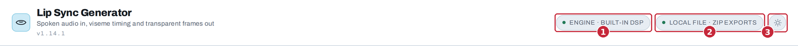

1. **Engine** — which analyser is running. Built-in DSP by default.
2. **Source** — where the file came from and how exports will be handed back.
   `Local file · ZIP exports` is the normal case.
3. **Appearance** — one button, light or dark. It opens on whatever your system
   is set to; click it once and your choice sticks between visits.

Under the title is the version — `v1.0.0` and so on. It is worth quoting in a
bug report, and it is the quickest way to tell whether the copy you saved to the
desktop is the one you have been reading about: the number in the window, the
number in **Diagnostics**, and the number in the README of every export are all
the same one, taken from the code rather than typed anywhere.


The line under the title bar is not a slogan. Everything happens in the
browser, nothing is uploaded, and the only thing the page ever fetches is a
`lips/` folder sitting beside it — see [Privacy](#privacy).

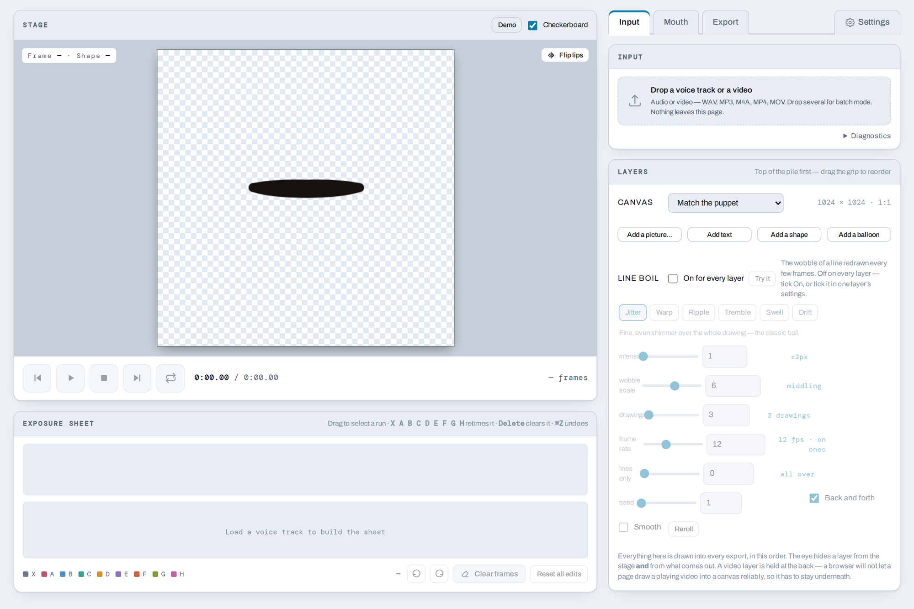

The left column is the work: the stage, and directly beneath it the exposure
sheet for what is on the stage. Neither is ever a tab that can be shut over the
other, because the whole job is reading the mouth against the timing — you
scrub the sheet and watch the picture. The right column is everything you set.
Below about 1200px of width — a narrow window, a tablet — the two columns
become one and the tabs sit under the sheet.

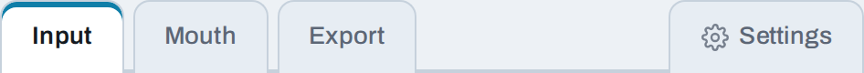

Three tabs for the work, and a gear at the far end for what is set once. Arrow
keys move between them when one has focus.

**Input** is the first and opens by default: the file, the clips in the queue,
who is in them, which picture each one wears, and the layer stack on top of it
— everything that answers "what are we working on" and "what is in the frame".
**Mouth** holds the shapes it is drawn with, and **Export** what comes out at
the end. The gear, **Settings**, is the analyser's settings and the script:
things you set once and leave, which is not what the first tab in a row is for.

Layers used to be a tab of its own. It is folded into Input because the stack
sits on the puppet, and "put a picture behind this character" should not be a
trip between two screens.

---

## Loading a clip

Everything you load lives in the **Input** tab, on the right: the drop area,
the queue of clips, the cast, the puppet rows and the layer stack. The script
and the analyser's settings are behind the gear at the far end of the tabs.

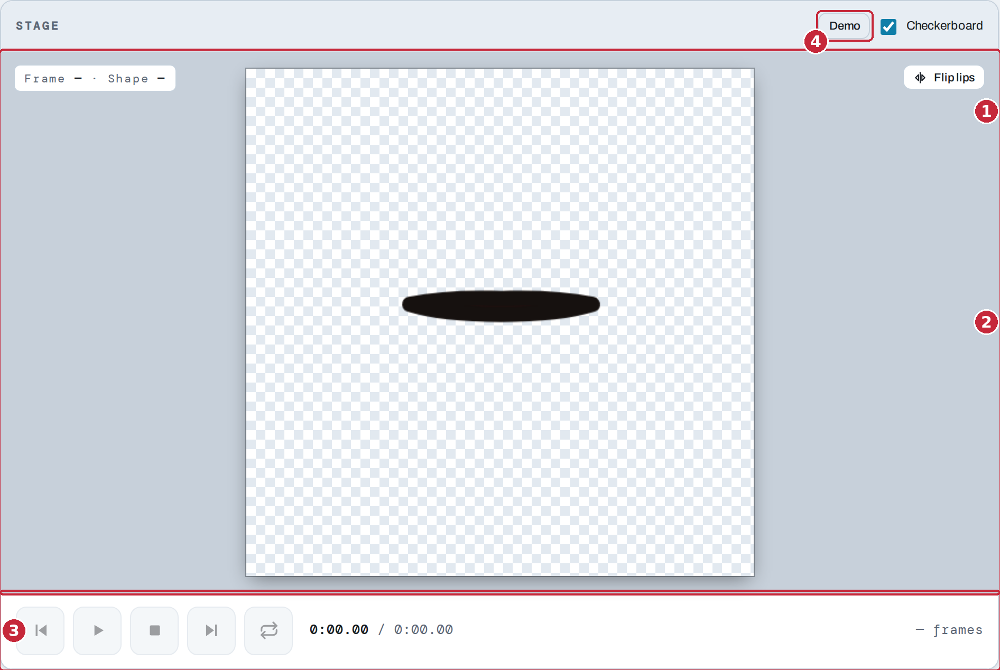

1. **Drop area** — drag a file here, or click to browse. WAV, MP3, M4A, OGG,
   FLAC, AAC, MP4, MOV, WebM. Drop several at once to start a queue.
2. **Stage** — where the mouth is drawn, over a checkerboard so you can see the
   transparency. With a video or a puppet loaded, the mouth sits over the
   picture.
3. **Transport** — play, stop and scrub, directly under the picture and sized
   to be hit without looking away from it. Greyed out until a clip is in.
4. **Demo** — loads a short recorded line and a drawn face, so there is
   something to look at before you have anything of your own. See
   [The demo](#the-demo).

A **video** file is treated the same way: the soundtrack is analysed and the
picture becomes the backdrop, so you can place the mouth exactly where the face
is. If the browser cannot decode the picture, the audio still works and a note
says so.

---

## Analysis

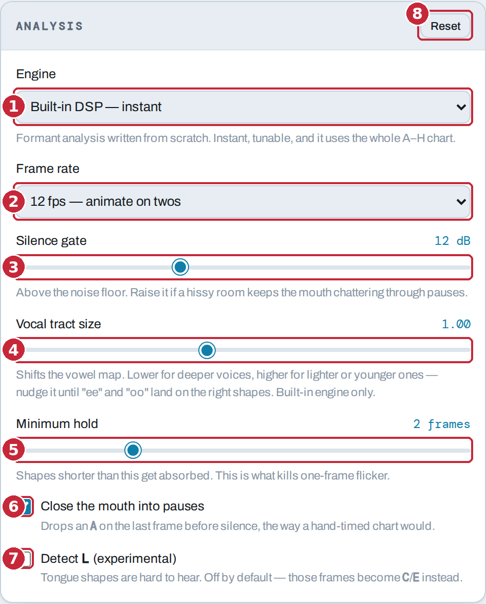

1. **Engine** — **Built-in DSP** is formant analysis written from scratch:
   instant, tunable, and it uses the whole A–H chart. **Rhubarb** is the
   PocketSphinx-based analyser, slower and less tunable, included for
   comparison.
2. **Frame rate** — the rate your animation runs at. 12 fps ("on twos") is the
   usual choice for character animation; 24, 25 and 30 are there for film and
   video. **Set this before you start hand-editing**, since changing it re-times
   everything.
3. **Silence gate** — how far above the noise floor counts as speech. Raise it
   if a hissy room keeps the mouth chattering through pauses.
4. **Vocal tract size** — shifts the vowel map. Lower for deeper voices, higher
   for lighter or younger ones. Nudge it until "ee" and "oo" land on the right
   shapes. Built-in engine only.
5. **Minimum hold** — shapes shorter than this get absorbed into their
   neighbours. This is the control that kills one-frame flicker.
6. **Close the mouth into pauses** — drops an `A` on the last frame before
   silence, the way a hand-timed chart would. On by default.
7. **Detect L** — tongue shapes are genuinely hard to hear, so this is off by
   default and those frames become `C` or `E` instead. Turn it on and check the
   result.
8. **Reset** — puts every analysis setting back to its default.

> **Which knob first**
>
> If the mouth flaps during silence, raise the **silence gate**. If it flickers
> during speech, raise the **minimum hold**. If the vowels are simply wrong —
> "oo" coming out as "ah" — that is **vocal tract size**.

---

## The stage and the transport

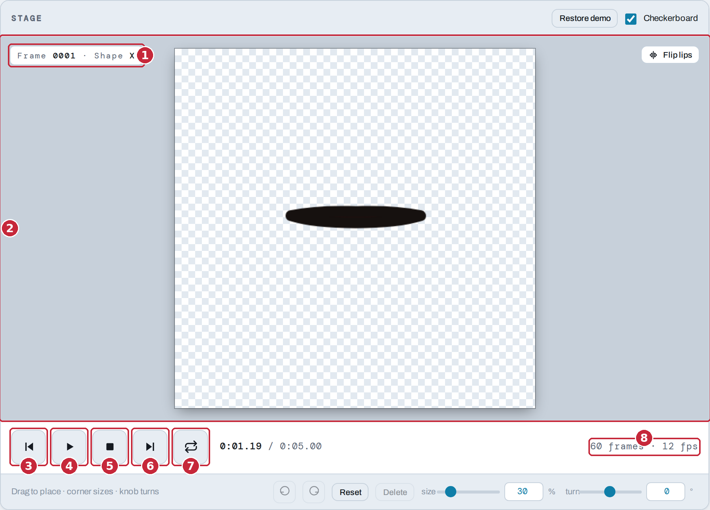

1. **Frame and shape** — which frame the playhead is on and which mouth shape is
   showing.
2. **Stage** — the mouth, drawn at the current frame. Click a cell in the
   **Chart** to preview any shape here.
3. **Jump to the start** — also <kbd>Home</kbd>.
4. **Play / pause** — also <kbd>Space</kbd>.
5. **Stop** — stops and rewinds.
6. **Jump to the end** — also <kbd>End</kbd>. Lands one frame short of the very
   end, because seeking to the last instant leaves most browsers showing black.
7. **Loop** — plays the clip round and round. Respects a trim.
8. **Frame count** — how many frames the clip is at the current rate.

The row naming the loaded file — its length, sample rate and channels, with the
**×** that clears it and **Diagnostics** beside it — is in the **Input** tab
with the rest of what is loaded.

---

## The exposure sheet

This is the working document: one cell per frame, coloured and lettered by mouth
shape, with the waveform above it.

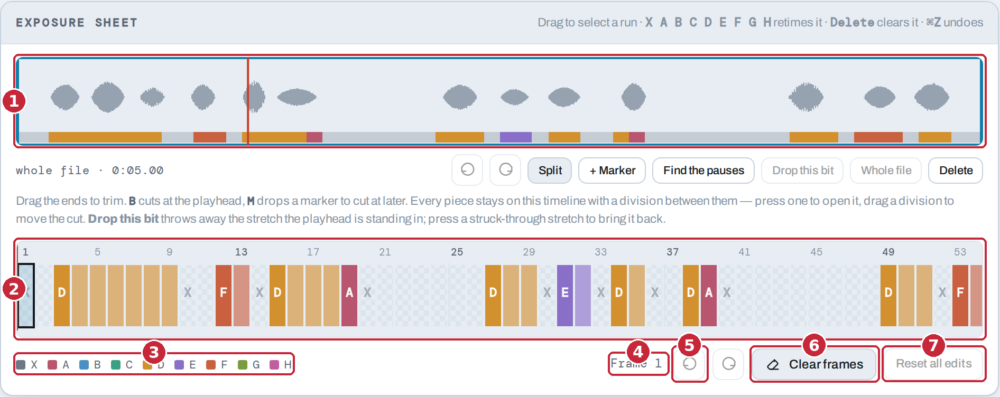

1. **Waveform** — the whole clip at a glance, with the shapes as a colour band
   underneath. Press anywhere to seek. It is also where trimming and splitting
   happen — see [Markers, splits and drops](#markers-splits-and-drops).
2. **The sheet** — one cell per frame. Drag across it to select a run. Scrolls
   sideways on a long clip.
3. **Legend** — which colour is which shape.
4. **Selection** — what is selected right now, in frames and seconds.
5. **Undo / redo** — also <kbd>⌘Z</kbd> and <kbd>⇧⌘Z</kbd> (<kbd>Ctrl</kbd> on
   Windows).
6. **Clear frames** — empties the selected frames back to rest.
7. **Reset all edits** — throws away every hand edit and returns to the raw
   analysis.

### The nine shapes

The Preston Blair set, which is also what Rhubarb writes. Every export ships all
nine PNGs even if the take only used five, so you can correct a frame later
without exporting again.

**C** and **D** are drawn 15% shorter than the classic proportion, and the
reason is practical rather than phonetic. Those two set the tallest frame in the
set, so they set the scale of the whole export: a Lego minifigure or a Barbie
head has perhaps a fifth of its face to spare for a mouth, and a D at full
height forced the entire sheet to be scaled down to fit it, which left every
other shape too small to read. Width, roundness, teeth and tongue are
untouched — it is only the opening.

| Key | Shape | Sounds |
|-----|-------|--------|
| `X` | Rest | silence |
| `A` | Closed | M, B, P |
| `B` | Slightly open | S, T, D, K, N, R, and "ee" |
| `C` | Open | "eh", "ae" |
| `D` | Wide open | "aa" |
| `E` | Rounded | "o", "aw", "er" |
| `F` | Puckered | "oo", W |
| `G` | Teeth on lip | F, V |
| `H` | Tongue | L |

### Fixing frames by hand

The analyser gets most of it. The last five per cent is yours:

1. Drag across the sheet to select the frames you want to change.
2. Press the letter of the shape you want — <kbd>A</kbd>…<kbd>H</kbd>, or
   <kbd>X</kbd> for rest. The whole selection changes.
3. <kbd>Delete</kbd> clears a selection back to rest.
4. <kbd>⌘Z</kbd> undoes.

Hand edits survive everything except **Reset all edits**: they are kept when you
change the frame rate, switch to another clip and back, or trim.

---

## Markers, splits and drops

All of this happens on the sheet's own waveform, which draws **the whole source
file**. After a cut it keeps drawing the whole file: each piece is marked out
and named, with a division between them, the way a timeline in an editor is.
The open piece is the bright one.

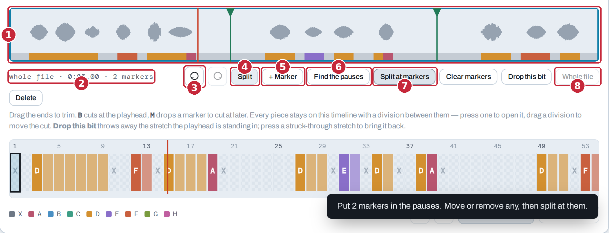

1. **The timeline** — drag either **end** of the open piece to trim it. Press
   another piece to open it, at the moment you pressed. Press anywhere in the
   open piece to seek. The green flags along the top are markers; the grey
   shoulders are divisions between pieces.
2. **Readout** — what is kept, out of how long, how many markers are down, and
   which piece of the file you are on.
3. **Undo / redo** — for the timeline itself: a cut, a dragged division, a
   trim, a drop, a marker. ⌘Z does it too whenever the timeline is the thing
   you last touched.
4. **Split** (**B**) — cuts the open piece in two at the playhead, there and
   then. If a marker is within a few frames, the cut lands on it.
5. **+ Marker** (**M**) — drops a marker where the playhead is. A marker is a
   bookmark: it cuts nothing, and you can leave as many as you like.
6. **Find the pauses** — drops a marker in every pause the analyser found. On a
   conversation this is usually the whole job.
7. **Split at markers** — cuts at every marker at once. Appears once there is a
   marker to cut at.
8. **Whole file** — puts the pieces back together: one clip spanning the whole
   recording again, with the trim undone and every dropped stretch restored.
   The clips strip goes with them.

**Drop this bit** throws away the stretch the playhead is standing in, bounded
by the markers either side. The audio is genuinely removed and everything after
it moves earlier; press the struck-through stretch to bring it back. **Delete**
removes this clip from the queue.

### Moving a cut after you have made it

Drag the division between two pieces. Both sides follow it — the first piece
ends where the second begins, always — and the piece that is not open is
re-analysed the next time you open it. This is the thing to reach for when a
cut landed half a word early.

> **Two people talking**
>
> Load the recording, press **Find the pauses**, check the flags are in the
> right gaps, then **Split at markers**. You get one clip per line. Now give
> the first speaker their mouth and press **Every other clip**
> (see [below](#different-lips-per-clip)), then do the same from the second
> clip. Moving along the timeline from there shows each character in turn on
> the stage, because opening a piece brings its own puppet and lips with it.

> **Why two words for one idea**
>
> A marker and a cut used to be the same thing — a "split point" that a second
> button later cut at. That made the common job (cut here, now) two presses and
> a concept, and the uncommon one (remember this spot) impossible without
> threatening a cut. They are separate now, and they meet in one place: a split
> lands on a marker if there is one within a few frames.

---

## Working on several clips

Drop several files, or split one, and a queue appears in the Input tab. Only
one clip is open at a time; the rest keep their own edits, placement and mouth
until you come back to them.

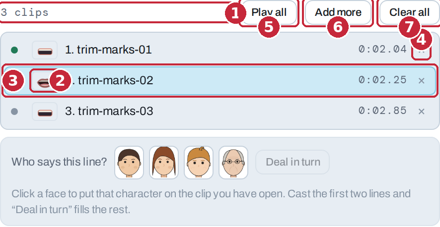

1. **Count** — how many clips are loaded.
2. **Lips** — the mouth that clip will be drawn with. This is what lets you see
   at a glance that two speakers are alternating.
3. **The open clip** — highlighted. Click any row to open it.
4. **×** — takes that clip out of the queue.
5. **Play all** — plays every line in order, from the top, in the stage you
   are already looking at. It opens each clip as it reaches it, so the lines of
   a split take follow one another closely; press it again, or touch the
   transport, and it stops where it is. Looping is put aside while it runs and
   given back afterwards, since a looping line would never end.
6. **Add more** — adds files to the queue.
7. **Clear all** — empties it.

Shared across the queue: the engine, the frame rate and the analysis settings.
Per clip: the frames and hand edits, the mouth style, the placement, the
keyframes, the blur patch, the script, the puppet, the layers and the canvas.

### Two characters on screen at once

The section above cuts between people, a clip per line. This one keeps them
**both on screen**, with the mouth moving on whoever is talking and the other's
resting shut — which is what a two-shot actually looks like. It is one clip,
marked up, with nothing cut.

**1. Put both characters on the stage.** Two picture layers, placed where you
want them. The canvas is probably worth setting wide for this.

**2. Give each one a mouth.** Select a character, drag the mouth onto their
face on the stage, then press **Put the mouth here** in that layer's settings.
The mouth is now described in *their* coordinates — move or resize them and it
goes with them.

The mouth layer moves above the faces when you do this, because a mouth
underneath an opaque drawing is an invisible mouth.

**3. Say who talks when.** With two characters pinned, a **Who is talking**
panel appears above the layer list: one row per stretch between your split
points, each with a picker. It fills in alternately as a head start — every row
is yours to change, and a three-hander or an interruption is just a different
answer in a picker.

Move a marker and the rows follow it. The assignments are carried across
by **overlap**, not by position in the list, so adding a marker in the middle
does not shunt every later line onto the wrong person.

> **Markers do two different jobs.** **Split at markers** cuts the take into
> separate clips, which is the section above. Leaving them uncut and filling in
> **Who is talking** keeps one clip and moves the mouth between faces. Same
> markers, same **Find the pauses**, two ways to use them.

**Only one mouth is ever drawn moving**, because only one person speaks at a
time. That is what makes this cheap: no second blur patch to manage, and the
one there is applies to the speaker only — smearing the
listener's face would be an odd thing to do to them.

### Coming and going

Every layer has **On from** and **Off at** in its settings, in seconds. Leave
them blank and the layer is there for the whole clip; fill one in and the
character arrives or leaves. It is the compositor that honours them, so it
holds in every export and not just the preview.

### A conversation between two characters

This is what the split is for. A recording of two people talking, cut into one
clip per line, with a different cartoon character on each — and the whole thing
back out as one piece.

**1. Set the scene up once, before you cut it.** Choose a puppet, place the
mouth, add any layers you want on every line. Everything here is carried to
each piece by the split, so doing it once does it for all of them.

**2. Cut it on the pauses.** **Find the pauses** under the sheet drops a marker
in every silence; **Split at markers** cuts at them. See
[Markers, splits and drops](#markers-splits-and-drops).

**3. Say who speaks the first two lines.** Click a line in the queue to open
it, then click a face under **Who says this line?**. That character goes on
that line — the stage changes with it, so you can see you got the right one.
Do the same on the second line with somebody else.

**4. Let the rest deal themselves.** A small **1** and **2** appear on the
faces to show who opens the scene and who answers; press **Deal in turn** and
they take alternate clips the rest of the way: Alice, Bob, Alice, Bob. Cast
three lines with three different faces and **Deal in turn** gives a
three-hander. Cast one and the button reads **Put on every clip**.

The running order is read off the queue rather than kept in a list of its own,
so changing who says line two changes who answers all the way down.

Each queue row shows a small picture of who is speaking it.

**What casting carries, and what it does not.** A character brings its picture,
its placement, its mouth position and size, and its lips. It does **not** bring
the other clip's timing: that belongs to one particular line's audio, and
stamping it onto a different line would move the mouth to a beat that is not
there.

Casting writes to the clips without opening them, so dealing twelve characters
round twelve lines takes a moment rather than twelve decodes. Open any line
afterwards and it is wearing what it was given.

**4. Take it out.** Three ways, and they are not alternatives so much as
different jobs:

| | |
|---|---|
| **The whole scene** | One file, every line end to end — see [The whole scene](#the-whole-scene) |
| **Final Cut Pro** | Every line on one timeline, each with its own character and voice, still editable — see [Batch export](#batch-export) |
| **Batch** | A zip with a folder per line, to assemble wherever you like |

---

## Mouth style

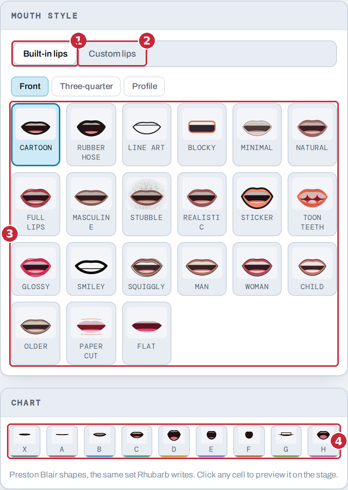

1. **Built-in lips** — twenty-one drawn styles, from a plain line to a rendered
   mouth, each in three head angles: **Front**, **Three-quarter** and
   **Profile**.
2. **Custom lips** — sets of pictures, either shipped with the app or added for
   this visit. See below.
3. **The styles** — click one to use it. With a queue up it applies to the open
   clip only.
4. **Chart** — all nine shapes in the current style. Click a cell to preview it
   on the stage.

#### The ones worth knowing about

Most of the twenty-one are variations on realism and colour and you can pick
one by looking. Six are not:

- **Smiley** — the big friendly cartoon mouth: a heavy black line, a solid black
  inside, a broad band of white across the top and a red tongue filling the
  floor. The difference from **Cartoon** is where the mass goes. In Cartoon the
  dark is the mouth and the teeth are a detail; in Smiley the teeth and the
  tongue take most of the opening, which is what makes it read as a grin rather
  than as a hole. This is the one for minifigures and brick characters.
- **Squiggly** — pen on paper. The outline is drawn three times, each pass
  nudged and turned a hair, so the line frays the way a real one does. For
  drawings that are themselves wobbly, where a clean vector mouth sits on the
  face like a sticker. The fraying is fixed per shape, not random per frame —
  shape D is the same shape D every time it comes round, or the mouth would
  boil.
- **Man**, **Woman**, **Child** and **Older** — the four that go with the drawn
  faces. The line weight matches the faces' own, the colour is picked against
  each one's skin, and the proportions follow the head: the child's narrower and
  rounder, the older one's thinner and flatter. Choosing a drawn face picks its
  own one of these; they are in the shelf as well because a puppet of your own
  may want the same treatment.

#### Head angles

A mouth chart belongs to a head angle: the same nine shapes drawn for a
character facing the camera are wrong on one that has turned. The turned views
are rebuilt geometry rather than the front view squashed. Three-quarter
foreshortens the far half and tucks that corner behind the cheek. Profile takes
the same idea further: the aperture loses its far corner altogether and becomes
a wedge, wide at the front and running to a point where the cheek takes over,
with the lips drawn as that same wedge grown outward — one ring of lip round one
opening, exactly as front-on. Width stops meaning how wide the mouth is and
starts meaning how far the lips stick out; the jaw does nearly all of the
opening and takes the mouth corner down with it; the upper lip is grown further
forward than the lower, so the leading edge steps back as it comes down, which
is the overbite that says "side of a face"; and a pucker gathers the opening
into a small hole up at the front while the lips themselves still run back to
the corner. Inside, two rows of teeth run from nothing at the corner to their
full depth at the front, leaving the dark as a slot that is widest where the
lips part rather than as a black bubble behind them.

Both turned views face **right**. Because the styles match across all three, a
character can keep its look through a turn — put the front set on one clip and
the three-quarter on the next. The pane opens on **Built-in lips** and **Front**
every time, whichever tab and angle you were last using.

#### Facing the other way

Two buttons, one for each half of the picture, and they are independent:

- **Flip lips** sits on the stage itself, top right, opposite the frame badge.
  It mirrors the mouth left to right wherever it is drawn — the stage, the
  chart, and every export. It works with a custom lip set as readily as with the
  drawn styles, and with no puppet at all.
- **Flip** sits on the **PUPPET** line, beside Replace and Remove. It mirrors
  the picture behind the mouth.

Both are horizontal only. A mouth upside down is not a mouth.

Which one you want depends on which half is facing the wrong way. A puppet
photographed looking left needs the lips turned round; a lip set drawn for a
left-facing character over footage of a right-facing one needs the puppet turned
instead. Pressing both mirrors the whole picture, which is occasionally what you
want and is not the same as pressing either.

Both belong to the open clip, so two speakers in a queue can face each other.

> **Final Cut is given a transform, not a flipped file**
>
> The **Final Cut Pro project** export ships the puppet as its own file. A
> mirrored puppet is therefore mirrored in the project — a scale of −1 across —
> rather than baked into a copy of your picture. You can see it in the inspector
> and take it off. The mouths are ours to draw, so those really are flipped in
> the PNGs.

Two things to expect:

- **Profile reads less precisely than front-on**, and that is true of profile
  lip sync generally rather than a limitation here. Front-on, `B` `C` and `D`
  differ mainly by how wide the mouth opens, and from the side that difference
  largely disappears. What survives is jaw travel and lip protrusion, so `A`,
  `F` and `G` still read strongly while the open vowels sit closer together.
- **The angle control is not a substitute.** It turns the mouth in the picture
  plane; a real turn foreshortens it and hides the far corner.

### Different lips per clip

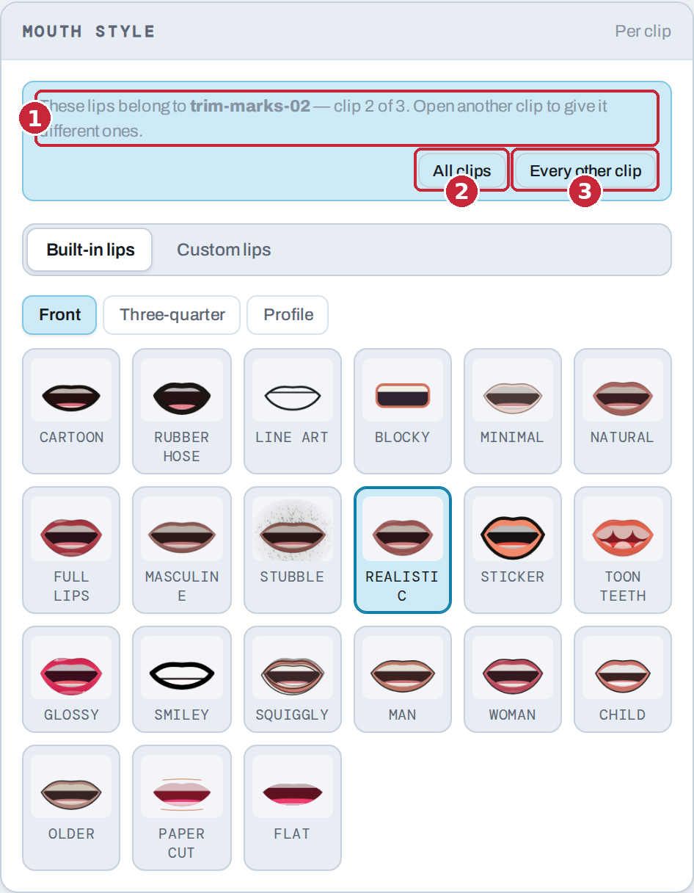

1. **Whose lips these are** — the picker belongs to the clip that is open. Open
   another clip to give it different ones.
2. **All clips** — give every clip in the queue these lips.
3. **Every other clip** — give them to this clip and every second one after it.
   This is the two-speakers-taking-turns case that splitting on the pauses
   produces.

### Your own lips

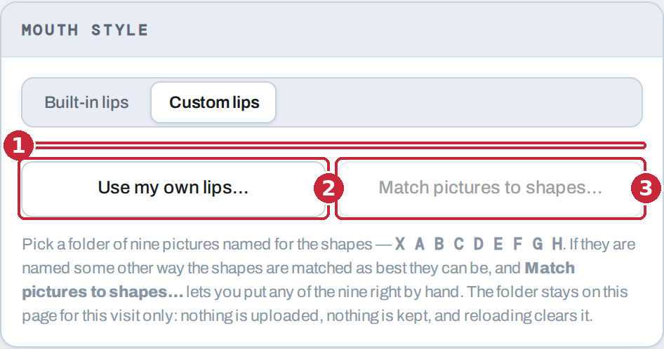

1. **The sets** — anything found in a `lips/` folder beside the HTML file when
   the page loaded, plus anything you have added this visit. A set showing `7/9`
   has two shapes no picture was named for; they are filled with a best guess.
2. **Use my own lips…** — pick a folder of nine pictures named for the shapes:
   `X A B C D E F G H`. It stays on this page for this visit only. Nothing is
   uploaded, nothing is stored, and reloading clears it.
3. **Match pictures to shapes…** — say which picture is which, by hand.

#### When the names don't say which shape is which

Pictures are matched to shapes by filename: a letter on its own, so `mouth-D.png`,
`D.png` and `04_D_wide.png` all land on `D`. When a name says nothing — a folder
of `frame01.png … frame09.png`, or one that calls its wide-open shape `aah` —
the leftovers are handed out in name order, counting numerically, which puts a
folder numbered in chart order (`X A B C D E F G H`) right on its own.

Where that guess is wrong, **Match pictures to shapes…** opens a list of the nine
shapes with a chooser on each: pick any picture in the folder for any shape, and
the chart, the stage and every export follow as you go. Shapes nobody named a
picture for are marked, so you can see which ones were a guess and which you
chose. **Match by name again** throws away your choices and re-runs the automatic
match.

It opens by itself right after an import that left anything to guess at, which is
the moment you still remember what is in the folder. A folder named for the
shapes is already right, so it stays out of the way.

> **Shipping your own sets**
>
> To have sets appear for everyone automatically, put them in a `lips/` folder
> next to the HTML file — one sub-folder per set, nine pictures inside each,
> named for the shapes. They are found on load. This only works when the page is
> served over HTTP; opening the file directly from disk blocks the folder scan,
> and the **Use my own lips…** button is the way in.

---

## A puppet to put it on

The mouth has to go on something. A video clip brings its own picture, but a
voice recording does not — so the picture is its own input, and a photograph
will do.

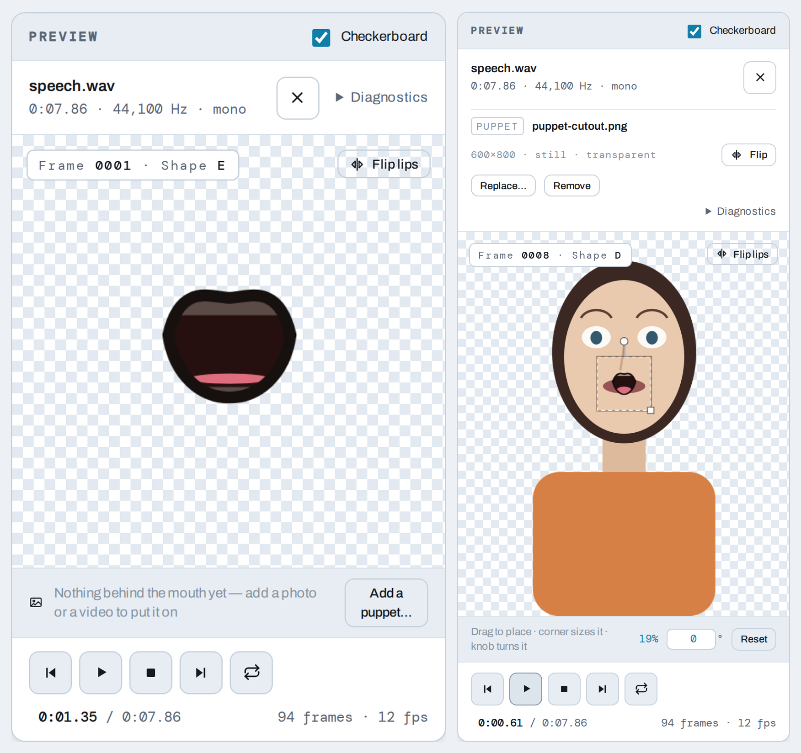

With audio alone the row under the stage says there is nothing behind the mouth
yet and offers **Add a puppet…**. Take a photo or a video; you can also drop
either straight onto the stage. A **PUPPET** line then appears under the file
row with its name, size, whether it is a still, and whether it is transparent,
plus **Replace…** and **Remove**.

A photograph is the easy case and the good one. It is a locked-off shot by
definition — nothing drifts, nothing needs tracking — so a picture of the doll
and a voice note is all it takes.

### Four drawn faces

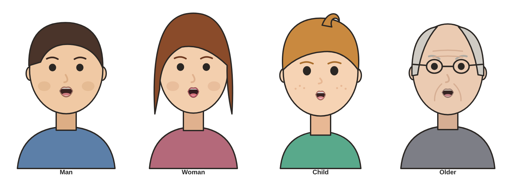

Beside **Add a puppet…** there are four small portraits: a man, a woman, a child
and an older person, drawn in the page rather than carried as pictures. Click
one and it becomes the puppet.

A face brings three things, not one: the picture, the place its mouth goes, and
the lip style drawn for it — **Man**, **Woman**, **Child** or **Older** from the
style shelf. Any one of them alone would leave you doing the other two by hand
for a face the app drew itself.

It brings them **the first time you use that face, and only then**. Come back to
it later and you get the lips you last had on it instead, because by then the
suggestion has stopped being help and started being a face overwriting work you
did. See [Heads keep their lips](#heads-keep-their-lips).

They are transparent, so they export like any other cut-out puppet, and they are
drawn at 900×1200, which is large enough that a 2048px export is not resampling
upward. The same four chips appear on the **PUPPET** line once there is a puppet,
so one face can be swapped for another without going back to the start.

They are deliberately plain, and they have no mouths. A face that already had
one would be answering the question it is asking.

### The puppet shelf

The four drawn faces and **everything you have loaded this visit** share one row
of chips. Choosing one switches to it. Nothing is thrown away by switching:
load a second drawing and the first stays on the shelf, one click away.

The shelf is in memory and lasts the visit. Nothing is written to disk, and
reloading the page clears it.

### Heads keep their lips

A chip is not a picture. It is a **character**, and a character is five things
that travel together:

| | |
|---|---|
| **The picture** | the file, and the crop it arrived with |
| **Its place** | where that picture sits in the frame |
| **Its mouth** | where the mouth sits on it, and how big |
| **Its lips** | which drawn style or imported set it speaks with |
| **Its mirror** | whether it is facing the other way |

Switch to another head and back and all five are as you left them. Try the same
line on three characters and each keeps its own mouth: the small one you set on
the doll does not follow you onto the drawing.

**The pin** sits at the end of the row of chips. Normally a drawn face you have
never used brings its own lips, once. Turn the pin on and nothing is ever
suggested — your style, your size, your placement and your keys survive every
change of head, including the first. Turn it off again and first-time
suggestions come back.

A loaded photograph never suggests lips either way. It has none of its own to
suggest.

### Moving the puppet itself

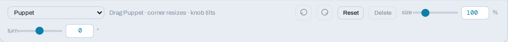

The strip under the transport has a **Mouth / Puppet** switch. It decides which
of the two the handles on the stage are driving — one set of handles, not two,
because four corners and two knobs over one face is a guess every time you
reach for one.

On **Puppet**, the whole picture gets the box: drag it to move, pull the corner
to resize, use the knob to tilt. The readouts and **Reset** beside the switch
follow whichever layer you are on.

A puppet starts at 100%, filling its frame, which is exactly what it always did.
Scale it down and the margin left behind is **transparent** — which is often the
point: a drawing cropped tight to the figure has no air around it, and a mouth
near the chin ends up hard against the edge of every export. Scale it up to push
in on a face photographed from across the room.

**The mouth travels with it — and only the mouth.** Move, resize or tilt the
picture and the mouth goes along. Place the mouth, decide the head is too big,
pull the corner — the mouth is still on the mouth.

Nothing else in the stack is tied to the puppet. A caption, a prop, a
background, a second character: those are placed in the **frame**, and they stay
where you put them when the puppet moves. The puppet and the mouth are one
thing, because a mouth means nothing anywhere but on a face; everything else is
a layer in the ordinary sense and moves on its own.

Three things worth knowing:

- The frame does not change size. It stays the puppet's own shape, which is what
  every export is built at, so moving the puppet never changes the dimensions of
  what comes out.
- **Flip** and the placement are the same mechanism now, so a mirrored puppet
  that has also been turned behaves the way you would expect rather than the way
  two separate features would.
- The mouth is placed on the face, and the face is the set. A set that drifts
  under a character would be a different feature altogether.

#### What Final Cut gets

A **still** that has been moved is rendered into the project exactly as you
placed it — the file in the zip is a full-frame PNG named `…-placed.png`, with
the transparency kept. It is still one layer you can move in Final Cut; it
simply arrives where you put it.

A **video** puppet cannot be rendered in a page without re-encoding it, so Final
Cut gets the clip as it is. The card says so when that applies, and you place it
there to match.

### Trimming the empty border

Pictures of puppets arrive with a lot of nothing round them — a phone photo of a
minifigure on a desk, a PNG exported at canvas size, a scan. That costs twice:
the mouth has to be shrunk to a few per cent of the frame to sit on a face that
occupies a fifth of it, and every export that carries the puppet carries the
empty margin at full resolution.

So the border is measured and cut on the way in, and 20px of it is put back so
nothing sits hard against the edge. The **PUPPET** line says `trimmed` when this
has happened and offers **Undo trim**; on a picture that was left alone the same
button reads **Trim edges** and will do it on demand.

What counts as empty is not a guess. A picture **with transparency** is trimmed
on its alpha. One **without** is trimmed against the colour its own four corners
agree on — and if the corners disagree, which is the case for any photograph
with a real background, nothing is cropped at all. That is why this can run
automatically without surprising anyone.

Trimming changes the frame, so the mouth's placement is moved with the picture
rather than being left to slide off the chin; undoing it moves the placement
back. Videos are not trimmed: the measurement is of one frame and a video's
subject moves out of it.

Once there is a puppet, everything the video path already offered turns on:
placement on the stage, the blur patch, **Video with mouth overlay**, and
Final Cut's **Match the picture**.

### It belongs to the clip

Not to the app. Each clip in the queue carries its own, alongside its own lips
and its own placement, so a two-hander split into lines can have one puppet on
the odd ones and another on the even ones. Leave a clip and come back and its
puppet is there.

**Take the audio away and the stage goes with it.** Removing the voice track —
the **×** beside the file, or **Clear all** — clears the whole stack: the
puppet, the mouth and anything else that had been put on it. The audio is the
clip, and what was built on it has nothing to stand on once it is gone. The
mouth used to survive that, sitting on an empty stage over whatever backdrop
was still there. The canvas is the exception and is kept on purpose: it is a
format, not a thing on the stage.

### When the lengths disagree

| | |
|---|---|
| A still | Takes the length of the take. There is nothing to disagree about. |
| A video shorter than the take | Plays **out and back again** — to its end, then in reverse to its start, then out again. |
| A video longer than the take | Cut to the take. The tail is not used. |

Out-and-back rather than a plain loop because a loop cuts from the last frame
to the first every time round, and on a puppet that jolt is the thing you
notice. Coming back the way it went has no seam in it at all.

> **The preview steps through the reverse half**
>
> A `<video>` cannot be played backwards, so the reverse leg is drawn by seeking
> rather than playing and moves at about twenty frames a second on the stage
> instead of smoothly. Scrub and every frame is exact, and the export renders
> every frame of it properly. It is only the live preview of the backwards half
> that is steppy.

**A puppet is always silent**, whatever its file contains. The voice track is the
voice track; two at once is nobody's intention.

### Transparency

If the puppet has an alpha channel — a cut-out character on nothing — the app
says **transparent** on the PUPPET line and keeps the checkerboard behind it on
the stage rather than a black ground, so you can see that it is cut out.

To keep it through an export, tick **Include the other layers** on **Animated
PNG** or **PNG frame sequence**. Those two become the whole picture rather than the
mouth alone: the puppet's own size, the mouth composited on top, and eight bits
of alpha all the way through.

**Video cannot hold transparency at all** — no browser will encode an alpha
movie, which is covered under
[Putting the lips on a puppet](#putting-the-lips-on-a-puppet) — so a cut-out
puppet comes out of **Video with mouth overlay** on black. That is what the two
PNG routes are for.

### Which exports carry the puppet

**Include the other layers** appears on six of the eight cards once there is a
puppet, and choosing a puppet ticks five of them. Each format does something
slightly different with it, because each format can hold something different.

| Export | Default | What it does with the puppet |
|---|---|---|
| **Final Cut Pro project** | on | Ships the puppet file in the zip and puts it on the storyline, with the mouths connected above it in lane 1. A layer you can still move, not pixels baked together. |
| **Chroma-key MP4** | on | The frame becomes the whole picture at the puppet's proportions instead of a square. A cut-out puppet's transparency fills with the key colour, so keying it out cuts it out again on the far side. |
| **Transparent GIF** | on | Every frame is the whole picture, quantised against one palette so nothing shifts colour between frames. The long edge is held to 800px whatever output size is chosen. |
| **Animated PNG** | on | The whole picture with a real alpha channel. The best of them for a cut-out. |
| **PNG frame sequence** | on | One PNG per frame, the whole picture, transparency and all. |
| **Sprite sheet + atlas** | **off** | Cells become whole pictures: nine for a still puppet with the line boil off, one per frame for a video or a boiled drawing. The atlas gains a `sequence` list saying which cell each frame wants. |

**Chart + exposure sheet** has no box — it is nine mouths by definition.
**Video with mouth overlay** has its own pair, described below.

Every one of these cards also has **Include the effects — line boil, drop
shadows**, ticked. Untick it and the frames come out without the wobble and
without the shadows, which is what you want when the grade or the finish is
being done somewhere else, or when a boil that reads nicely at full size reads
as noise at 256px. Everything else about the picture is unchanged.

Two things worth knowing:

- **The boxes belong to the clip only through its puppet.** They keep their
  setting when you click to a clip that has no puppet and back again, so a batch
  run exports what you set, not what the last clip you looked at happened to
  have.
- **A clip's own footage does not tick them.** If the thing behind the mouth is
  the video you loaded as the voice track rather than a puppet you chose, the
  boxes appear but stay clear — that export has always been the mouth alone and
  the footage is already on your timeline.

> **Final Cut and a short puppet**
>
> The app plays a puppet shorter than the take out and back. A project cannot
> say that in one clip, so the storyline runs to the puppet's own length and the
> rest is a gap. To match it, copy the puppet, paste it into the gap and reverse
> the copy with **Retime > Reverse Clip**. The README in the zip says the same.

---

## Layers

The layer stack lives in the **Input** tab, under what is loaded.

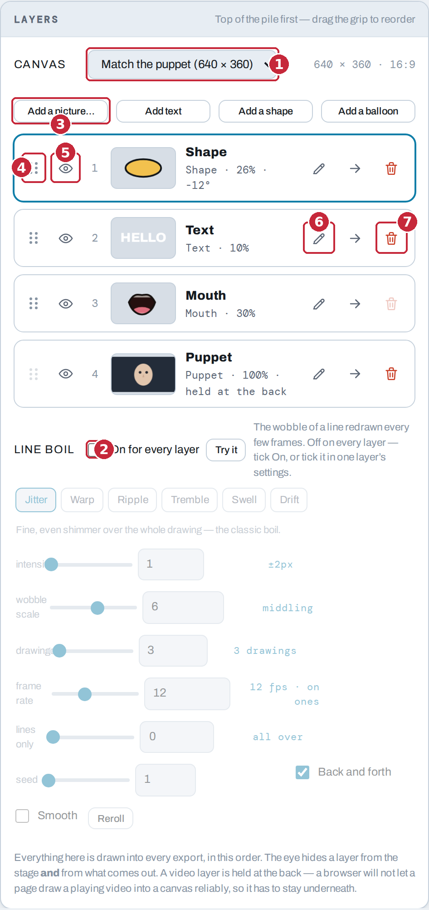

1. **Canvas** — the frame everything is composed into. See below.
2. **Add** — a picture from disk, a line of text, a shape, or a balloon.
3. **Line boil** — the wobble of a redrawn line, under the list. See below.
4. **The grip** — drag it to reorder. Top of the list is the front of the
   picture.
5. **The eye** — hides a layer from the stage **and** from every export. Hidden
   is not "faded"; it is not there.
6. **The pencil** — opens that layer's settings underneath the list, and
   **Done** shuts them again.
7. **The bin** — deletes the layer. The mouth cannot be deleted; the puppet's
   bin removes the puppet.

The picture is a stack. Pictures, text, shapes and the mouth itself, in an
order you choose, each with its own placement, opacity and drop shadow. A hat,
a speech bubble, a name plate, a second character, a coloured ground behind a
cut-out — all of it composes into every export rather than waiting for another
application afterwards.

The handles work on **anything in the stack** — a puppet is not required. A
picture added through **Add a picture…** is a layer, not a puppet, and the
puppet row goes on saying there is nothing behind the mouth; that is correct
and it does not stop you placing anything.

**Everything on the stage can be taken back.** Moving, resizing or turning a
layer, adding or deleting one, changing anything in a layer's settings,
choosing a puppet or removing one: the two arrows on the placement strip walk
back and forward through all of it, and <kbd>⌘Z</kbd> does the same.

The stage and the exposure sheet keep their own histories, because a frame's
shape and a layer's placement are not the same kind of thing. <kbd>⌘Z</kbd>
takes back whichever you did most recently, so pressing it repeatedly retraces
your actual order across both. A drag is one step, however far you dragged, and
a slider pushed across its range is one step rather than two hundred. Opening
another clip starts that clip's own history — undoing past the moment it opened
would be undoing into somebody else's stack.

**Clicking a layer on the stage selects it**, so the usual way to move
something is to point at it and drag. Where two layers overlap the *smaller* one
wins — the mouth beats the face behind it, a logo beats the picture it sits on,
and bare background gives you the puppet. That is deliberately not "topmost
wins": a full-frame picture is the whole stage, and topmost would make the mouth
unreachable the moment anything was added above it.

The pencil opens that layer's settings **directly beneath its own row**, so
there is never a question of which layer a box of settings belongs to.

The arrow on each row also puts the stage handles on that layer, which is the
same thing as choosing it in the dropdown on the placement strip. Then drag to
move it, pull **any of the four corners** to resize, use the knob to tilt —
exactly as for the mouth. All four corners do the same job, so you grab
whichever one is in front of you rather than reaching round the picture for a
particular one. A corner or the knob always belongs to whatever is already
selected, so a handle sticking out past a neighbour still works.

Three things that are not arbitrary:

- **The mouth is a layer like any other.** Drag something above it and that
  thing crosses in front of the face. The mouth keeps what only it has: the
  blur patch that hides a printed mouth on whatever is behind it, in its own
  settings under the pencil on the Mouth row.
- **A video layer is held at the back.** This is a browser limitation rather
  than a preference — a page cannot reliably draw a playing video into a
  canvas, so the one video has to stay a real element underneath, and nothing
  can be put beneath it. Stills have no such problem and move freely.
- **Layers belong to the clip.** A two-hander split into lines can have a
  caption on one and a prop on the next, and switching between them brings each
  one's stack back.

Every layer's settings carry **opacity** and a **drop shadow** — softness,
offset, colour and strength, all as fractions of the frame, so a shadow looks
the same at 512px as it does at 2048. Text adds its words, colour, outline,
typeface and weight; a shape adds its type, fill, edge, proportions and corner
rounding.

### Balloons and panels

**Add a balloon** puts a speech balloon on the stage with words already in it.
Any shape layer can be any of these, from **Shape** in its settings:

| Shape | What it is for |
| --- | --- |
| **Rectangle**, **Ellipse** | Plain blocks — a ground behind a cut-out, a plate under a name |
| **Speech balloon** | Someone is talking. A tail you aim at them |
| **Thought balloon** | A cloud with a trail of bubbles |
| **Shout burst** | A spiked balloon, with one long point for the tail |
| **Whisper balloon** | The same body drawn with a broken line |
| **Caption panel** | The narration box, double-ruled, square-cornered |
| **Banner** | A ribbon with notched ends, for a title |

A balloon or a panel carries its own **words** — type them into the settings
and they wrap to fit inside the shape, so a balloon is one layer rather than a
bubble and a text layer you then have to keep together. Word size, colour and
typeface are there beside them.

**Tail at** aims the tail in degrees, clockwise from the right: 125° is
down-and-left, 55° is down-and-right. **Tail out** is how far it reaches past
the balloon. Set it to nought and the tail goes away, which is what you want
for an off-screen voice. The shout burst has **Points** and **Point depth** as
well.

Balloons are layers like any other, so they take the same placement handles,
the same opacity and drop shadow, the same **On from** / **Off at** times — a
balloon that appears on the line it belongs to and goes again afterwards is two
numbers, not an edit in another program.

### Animated pictures

A picture layer can be an **animated GIF** or an **animated PNG**, and it plays.
Drop one in and it is decoded frame by frame; the row says how many frames it
has, and its settings grow three controls:

| | |
|---|---|
| **Loop** | **Repeat**, **Play once, then hold** the last frame, or **Back and forth** |
| **Speed** | 5% to 800% of the file's own timing |
| **Start at** | How far into the take it begins, so two animations need not be in lockstep |

It is **deterministic**, like everything else that moves here. Which frame you
see is worked out from the clip's frame number and the file's own delays, not
from a clock — so the preview and every export agree, scrubbing backwards shows
what scrubbing forwards showed, and exporting twice gives the same file.

Both formats are decoded in the page. Pointing an `` at the file and
letting the browser animate it would be easier and is wrong: `drawImage` copies
whichever frame that element happens to be showing, a detached image never
advances in some browsers, and where it does advance it does so on wall-clock
time — which would make the picture a function of when you looked.

A long or large animation is held at 300 frames or about 420MB of decoded
frames, whichever comes first; past that the layer keeps its first frame and
says so. A still picture is unaffected and is offered none of these controls.

> **One size, one meaning.** Every layer is placed by the same four numbers —
> across, down, size and angle — and size is a percentage of the frame's width.
> A layer's own proportions do the rest, so a tall picture stays tall.

**Size, angle and opacity have a slider *and* a number field**, both in a
layer's settings and in the strip under the stage. The slider is for finding a
value, the field for saying one — 2% to 400% across ninety pixels is four
percent a pixel, which is no way to set 113%. Type into either and the other
follows. The strip's controls drive whichever layer the handles are on, so they
follow the selection the same way the handles do.

**Delete** on the strip removes the layer the handles are on, so a picture can
go without scrolling to the list. It refuses the mouth.

A layer **bigger than the frame** keeps its handles: the real corner would be
off the edge of the stage where no pointer can reach it, so the corner and the
knob are pulled back inside. Scaling is a ratio from wherever you grabbed and
turning is an angle about the centre, so neither gesture changes meaning.

### The canvas

The frame used to be whatever the puppet was: a 900×1200 drawing made a
900×1200 export. That is still the default, and **Match the puppet** says so
with the numbers in it. But it is a poor rule once there is a stack — a caption
needs room under the chin, and a 16:9 delivery needs 16:9 whatever shape the
character is.

So the canvas can be set: 1920×1080, 1280×720, 1080×1920, 1080×1080, or a size
you type. Everything downstream follows it — the stage, all eight exports, and
Final Cut's **Match the picture**.

**You can see the frame.** The preview draws it as a bordered sheet with the
checkerboard inside it and a plain surround outside, so changing the canvas
visibly changes the shape of what you are making: pick 16:9 and bands appear
above and below, pick vertical and they move to the sides. The checkerboard
marks the frame and only the frame — painted across the whole panel, as it used
to be, it claimed that parts of the panel which are not in the frame at all
would export transparent, and left nothing on screen to show what a canvas
change had done.

**Fit everything in the stack** is the one to reach for when something is
hanging over the edge. The canvas line says so when it happens — *"2 layers off
the edge"* — and this grows the frame until they are not, **without the stack
growing with it**: it resizes and re-places in one step, so every layer keeps
the size and position it already had. Without that second half it would chase
its own tail, since a layer at 220% of the width is 220% of whatever the width
becomes.

It is a measurement, not a mode: it works out a size once and then behaves like
any other canvas you typed, so adding a layer later does not silently move the
frame — and with it every placement.

Placements are fractions of the frame, so changing it **reflows**: a layer in
the middle stays in the middle, one at 20% across stays at 20% across. That is
what keeps a composition recognisable through a resize. The alternative —
holding pixel positions and cropping — pushes work off the edge where you
cannot see it to drag it back.

A puppet keeps its own proportions inside the frame. At 100% its width is the
frame's width; a portrait drawing in a landscape frame is not stretched to fit,
it simply does not fill the sides.

**A new puppet is measured against the frame before it lands.** Its size is its
width as a fraction of the frame, so 100% was the right arrival for as long as
the frame *was* the puppet — and badly wrong as soon as it is not: a 900×1200
face dropped on a 1920×1080 frame at 100% is 1920 wide and 2560 tall, a chin
filling the screen. So a puppet now arrives at whatever size fits the frame it
is landing on, top to bottom, and the mouth comes with it: the same place on
the face, scaled to match. On a canvas that matches the puppet this is exactly
100%, so the ordinary case is untouched. It applies to a picture you import, a
drawn face you pick, and a character dealt round the queue.

**The format outlives the clip.** Once a canvas has been chosen it is the one
every clip gets — the pieces of a split, the next file you load, and whatever
you load after clearing the audio. A clip that was given its own canvas keeps
it; only clips that have never been set follow the standing choice. Before this
a new clip quietly fell back to **Match the puppet**, which is how a take cut
into eight ended up with eight different frame sizes.

### Line boil

The wobble a drawing has when a human redraws it for every frame. Traditional
animation has it for free; vector animation has to put it back on purpose, and
without it a mouth cut onto hand-drawn artwork sits on the page like a sticker,
perfectly still while everything around it breathes.

**It is off on every layer to start with.** The tick in the Line boil row turns
it on for the whole stack; the tick in a layer's own settings turns it on for
that one.

#### Six kinds

| | |
|---|---|
| **Jitter** | Fine, even shimmer over the whole drawing — the classic boil. |
| **Warp** | Broad taffy pull. Whole limbs breathe in and out of shape. |
| **Ripple** | Concentric waves from the centre, like heat off a road. |
| **Tremble** | Noise plus grit. Rough, nervous, hand-inked-at-2am. |
| **Swell** | A slow breathing pulse in scale, with a light shimmer on top. |
| **Drift** | Registration wobble — the paper shifts on the pegs, lines stay clean. |

Five of the six move parts of the drawing by *different* amounts, which is what
a hand does and a transform cannot. **Drift** is the exception: it moves the
whole sheet as one, so the line quality is untouched — nothing is resampled.

#### The controls

| | |
|---|---|
| **intensity** | How far the drawing moves, 1 to 12, with the screen pixels beside it. Starts at **1** — the gentlest there is, which is what a drawn line usually wants. |
| **wobble scale** | How big each wobble is. Low is a slow bend through a limb; high is a fine tremble along the line. |
| **drawings** | How many distinct drawings cycle, 2 to 12. This is also how many warps get made, so it costs something. |
| **frame rate** | How fast they cycle, in their own frames a second. Against the clip's rate this is what "on twos" means, and the readout says so. |
| **lines only** | How much the wobble sticks to the lines. At 0 everything warps evenly; turn it up and flat fills stop swimming. |
| **seed** / **Reroll** | A different set of drawings from the same settings. |
| **Back and forth** | Play the cycle out and back, so the loop has no jump at the join. |
| **Smooth** | Sample between pixels instead of snapping to the nearest. Softer edges, slower to make. |

Every one of them has a slider and a number field: the slider to find a value,
the field to say one.

#### What it does not do

It is **deterministic** — the displacement comes from value noise seeded by the
layer, the drawing number and the seed, never from a random draw. The preview
and the export agree frame for frame, scrubbing backwards shows what scrubbing
forwards showed, and exporting the same clip twice gives the same file.

Each drawing is **warped once and kept**. That is why the drawing count is the
setting that costs: three drawings is three warps, not three per frame. Changing
any setting throws the cached drawings away and they are made again.

A **video puppet cannot boil**. It is the element under the canvas rather than
something drawn into it, and its tick says so.

A **background grows a little** when it boils. The warp pulls each pixel from
somewhere nearby, so a layer that reaches the edge of the frame is asked for
paper it does not have, and what comes back is nothing — a ragged pale fringe
all round the picture. Any layer that covers all four edges is quietly blown up
by enough to cover the warp's reach before it is warped, and the frame shows
the middle of it. A couple of percent of scale on a background, and no fringe.
Layers that do not reach the edge are untouched.

The boil **comes through every export**. The GIF, the animated PNG and the
sprite sheet all save work on a still puppet by making one picture per mouth
shape and repeating it — which is right, and was throwing the boil away, since
the whole point of it is that the drawing changes every few frames. With boil
on anywhere in the stack they render every frame.

> **It plays itself.** Boil is a different drawing every few *frames*, so on a
> paused preview it is one still picture and a change to it looks like it did
> nothing — the single most common reason people think it is broken. So:
> ticking it on, **letting go of any slider**, committing a typed number,
> choosing an effect or rerolling the seed all warp the drawings, say
> **Boiling…** while they do, run the preview through a couple of seconds and
> put the playhead back. Nudge another slider while it is playing and the new
> setting takes over rather than being refused. **Try it**, beside the switch,
> watches it again on demand.

## Placing the mouth

With a video loaded, the mouth is placed directly on the picture.

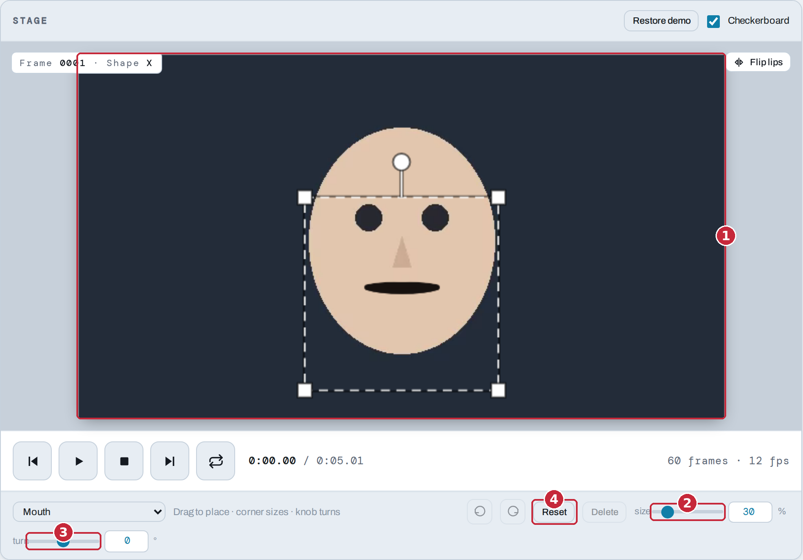

1. **The stage** — **drag** the mouth to move it, drag the **corner** to size
   it, and drag the **knob** to turn it. Hold <kbd>Shift</kbd> while turning to
   snap to 15°.
2. **Size** — as a percentage of the frame.
3. **Angle** — type an exact number of degrees if you would rather.
4. **Reset** — back to the centre at the default size, square on.

The placement is **baked into the exported pictures**. A Final Cut project or a
frame sequence drops onto your timeline at 100% and lands exactly where the
preview showed it — no transform needed at the other end.

---

## Blur patch

It lives in the **mouth layer's own settings** — the Layers list is in the
**Input** tab, so press the pencil on the Mouth row and it opens underneath.
It belongs to the mouth, so that is where it is, and it is the only place it
is: there used to be a second copy of it in a panel under the stage, which is
a good way to end up with two controls fighting over one setting.

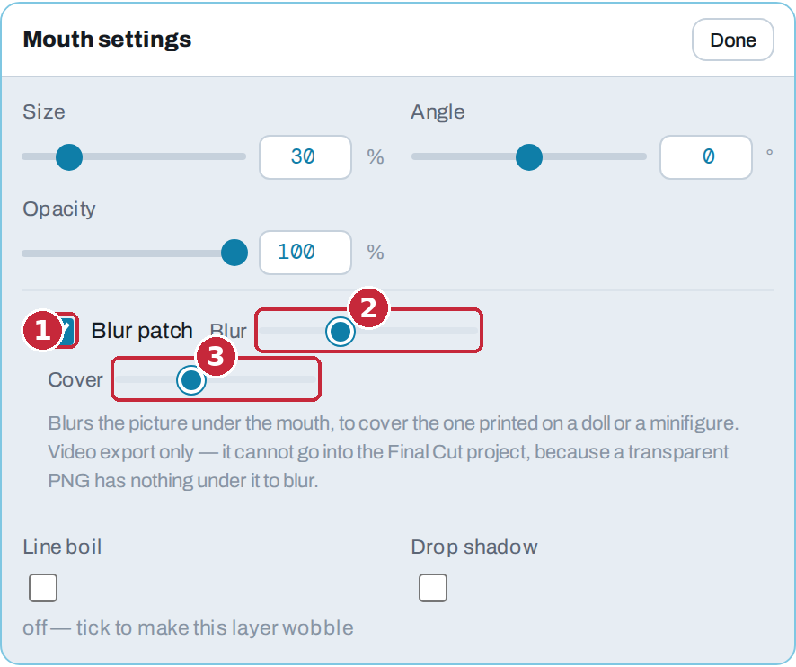

1. **Blur patch** — blurs the picture underneath the mouth, to cover the one
   printed on a doll or a minifigure.
2. **Blur** — how strong.
3. **Cover** — how much area it covers.

It appears once there is a picture with a mouth on it to blur.

> ⚠️ **Where the blur does and does not go**
>
> It is baked into **Video with mouth overlay** only. It cannot go into the
> Final Cut project, because a transparent PNG has nothing underneath it to
> blur.

> **Keyframes have gone**
>
> There used to be keyframes beside the blur: set a key, scrub, drag the mouth,
> set another, and it interpolated between them to follow a moving shot. They
> were removed in v1.14.0. The honest reason they did not work well is that a
> mouth following a head is a tracking problem, and straight lines drawn
> between hand-set keys are not a tracker. For footage that moves, export
> **Video with mouth overlay** and keyframe it in an editor that can see the
> picture — which is work Final Cut and Premiere do properly.

---

## Script

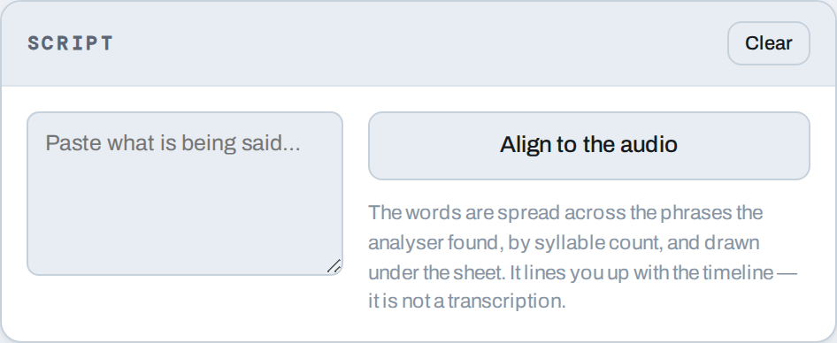

The Script panel is in the **Input** tab. Paste what is being said and press **Align to the audio**. The words are spread
across the phrases the analyser found, by syllable count, and drawn under the
sheet.

It is a way of finding your place on a long clip — "this is the bit where she
says the name" — not a transcription, and not something the analysis uses.

---

## Exporting

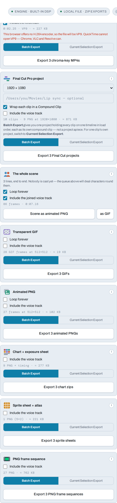

Every format is a card, and every card carries its own options and its own
button. Read the card, set what it offers, press the button at the bottom of it.

A card shows only what changes: its options, its size estimate, and any warning
that applies right now. What the format is and what it is good for lives behind
the small **i** in the corner, so that eight cards fit on a screen instead of
two. Click the **i** to read it, click anywhere else or press **Esc** to put it
away; only one opens at a time.

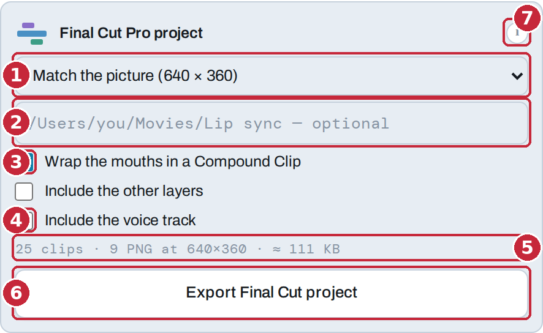

1. **Frame size** — the timeline the project will be built for. "Match the
   video" appears when a video is loaded and is the right answer when you are
   cutting over that footage.
2. **Media folder** — leave it empty and the project points at the pictures
   beside it, so the unzipped folder just works. Fill in where the folder will
   end up and the paths become absolute instead.
3. **Wrap … in a Compound Clip** — the run of mouths arrives as one item you can
   slide, trim and stack, instead of dozens of one-frame pieces. Double-click it
   in Final Cut to get at the individual shapes, or
   **Clip > Break Apart Clip Items** to lay them out loose.
4. **Include the voice track** — puts the audio in the zip beside the pictures.
   Off by default. Every card has its own.
5. **Estimate** — roughly what you are about to get, before you commit.
6. **The button** — does the export. It always says what it is about to do.
7. **Info** — the notes about this format: what it is, and what to watch for.

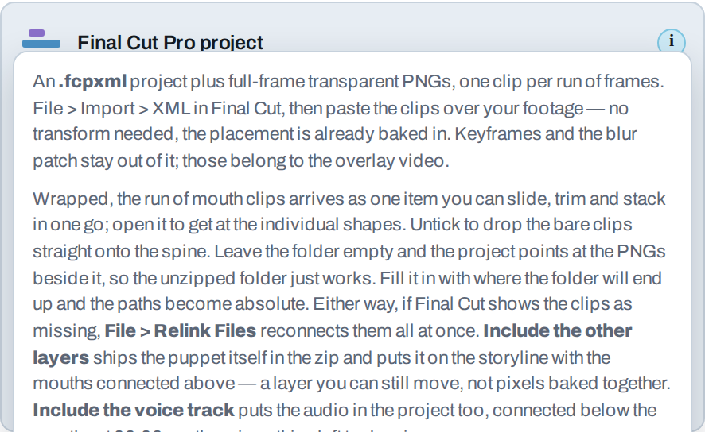

The notes, open. Warnings never go in here — "this browser cannot decode the
picture", and the one about what a batch run will do, stay on the face of the
card where you cannot miss them.

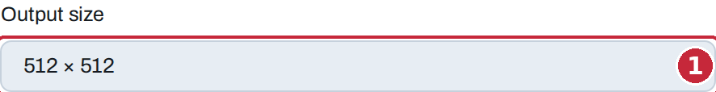

1. **Output size** — the pixel size of the mouth pictures, used by the GIF,
   sprite sheet, frame sequence and chart exports. The Final Cut project,
   chroma-key MP4 and overlay video have their own size on their own cards,
   because those are frame sizes rather than mouth sizes.

### The eight formats

| Format | You get | Good for |
|--------|---------|----------|
| **Chart + exposure sheet** | Nine transparent PNGs plus frame-by-frame timing as JSON and CSV | After Effects, Blender, Spine — the small, sane option, and the one to reach for first |
| **Final Cut Pro project** | An `.fcpxml` project plus full-frame transparent PNGs, one clip per run of frames — and the voice track and puppet in the project too, if you asked for them | Cutting over real footage in Final Cut. Import > XML and paste over your clip |
| **Transparent GIF** | An animated GIF with a see-through background | A slide, a web page, a chat window — anywhere without a matte |
| **Animated PNG** | The same animation as one `.png` file, with a real alpha channel | Anywhere the GIF's hard edge shows. Three times the size of the GIF and worth it over video |
| **Sprite sheet + atlas** | One PNG with all nine shapes packed in, plus a coordinate map | Game engines and web animation |
| **PNG frame sequence** | One numbered transparent PNG for every frame | Dropping straight onto a timeline. The cleanest matte — and it gets big fast |
| **Chroma-key MP4** | The mouth over a solid key colour, voice track muxed in | Any editor that can key. Note the chroma is half-resolution, so the edge is softer than the PNG alpha |
| **Video with mouth overlay** | Your source video with the mouth burned into it | A finished clip in one step. The only export that carries the blur patch |

> **Every export says which one it is**
>
> The file name is the clip's, with the format on the end in capitals:
> `speech-CHART.zip`, `speech-FCPXML.zip`, `speech-GIF.gif`, `speech-APNG.png`,
> `speech-SPRITE.zip`, `speech-FRAMES.zip`, `speech-CHROMA.mp4`,
> `speech-OVERLAY.mp4`. A batch zip carries the same tag. Eight files of one
> take otherwise differ by a word nobody reads, and Final Cut puts the file name
> on the clip — so the wrong one goes on the timeline and looks right until it
> does not.

> **Everything ships the whole set**
>
> Even if a take never uses `G` or `H`, those pictures are in the zip. That is
> what lets you correct a frame in your editor a week later without coming back
> here.

> **Timing: the GIF and the animated PNG run at a constant frame rate**
>
> Both used to write a held shape as one long frame — six frames of `B` as a
> single picture with a six-frame delay. Smaller, and correct in a browser, but
> it made the file **variable**-frame-rate, and an editor importing one has to
> place each of those frames on its own grid by rounding up. A twelve-frame
> animation on a 25 fps timeline came out about 14% long, and the error only
> ever went one way.
>
> So there is now one frame for every frame of the take, all the same length. A
> held shape is a *hold frame* — a single transparent pixel that changes nothing
> and costs about thirty bytes — so the files are barely larger and the rate is
> declared and constant, which is what lets an editor conform the clip the way it
> conforms any other clip: by repeating frames and keeping the length. Most do.
> Final Cut, on a long take, still does not — see the next box.
>
> **The animated PNG is exact.** It carries its own denominator, so a frame at
> 12 fps is written as the fraction 1/12.
>
> **The GIF is within a frame.** Its delays are whole hundredths of a second and
> 12 fps is 8.3333 of them, so the GIF is written at the nearest rate a hundredth
> can express — 8 hundredths, or 12.5 fps — and the mouth track is sampled at
> that rate. The total comes out right and no frame is more than half a frame
> from where it would have been.
>
> **If it still does not line up**, set the frame rate in **Analysis** to your
> timeline's. No frame duration lands cleanly on every grid — 1/12 of a second
> is 2.08 frames of 25 and 2.5 frames of 30 — so matching the two rates is the
> one thing that is exact under every reading.

> **Final Cut and long takes: a known one**
>
> Final Cut Pro does not always hold the length of an imported animated GIF or
> PNG, and the error grows with the length of the take — a two-minute one can
> arrive several seconds long. It is the import rather than the file: the same
> exports line up exactly in ToonSquid and in a browser, and the frames
> themselves are all the same length with the rate declared.
>
> Three ways round it, best first:
>
> 1. **Use the Final Cut Pro project export.** It is built for Final Cut and is
>    frame-accurate by construction — and it gives you the mouths as clips you
>    can already edit rather than one item to fight with.
> 2. **Work in shorter pieces.** Split the take into lines and export each
>    (see [Markers, splits and drops](#markers-splits-and-drops)). Drift you cannot see
>    over ten seconds is obvious over two minutes.
> 3. **Retime the clip in Final Cut.** Select it, **Modify > Retime > Custom**,
>    and set the duration to the audio's. One factor across the whole clip, so
>    the mouths stay in step with each other.

### The whole scene

With a queue loaded, a card appears above the others: **The whole scene**. It is
the conversation as one continuous file — every clip in the queue, end to end,
each line wearing whoever was cast on it.

The zip holds three things: the picture, the joined voice track in the same
order, and a note listing the lines with who speaks them and when.

| | |
|---|---|
| **Scene as animated PNG** | A real alpha channel and every colour. One walk through the queue. This is the one to use. |
| **as GIF** | Transparency as one colour, cut to 255 of them. Walks the queue **twice** and takes about double the time, because a palette has to be counted across the whole scene before any of it can be indexed — a palette taken from the first line alone would band every character who came after. |

**The clips are butted end to end**, not placed at their original offsets in the
source file. That is deliberate: a split cuts on the *middle* of a pause, so
half of each pause ends one line and half begins the next, and butting them
together reproduces the original timing exactly. Laying them at source offsets
would faithfully reinstate the stretches you had just dropped.

**The frame is taken from the first line.** Every placement in the app is a
fraction of the frame and a puppet keeps its own shape, so a line whose
character is a different shape sits in the middle of that frame rather than
being stretched to fit. If you want a particular size for the whole scene, set
a [canvas](#the-canvas) before exporting.

The scene is the open clip put back where it was found when it finishes, so an
export never quietly moves which line you were working on.

---

### Batch export

With more than one clip loaded, the first thing on the Export tab is the
question the whole tab turns on: **All *n* clips**, or **Just this clip**. It
sets every format card below it in one press.

Every card then carries the same two-way switch of its own, so one format can
disagree with the rest — when it does, the switch at the top says *set per
format below* rather than claiming an answer it no longer has.

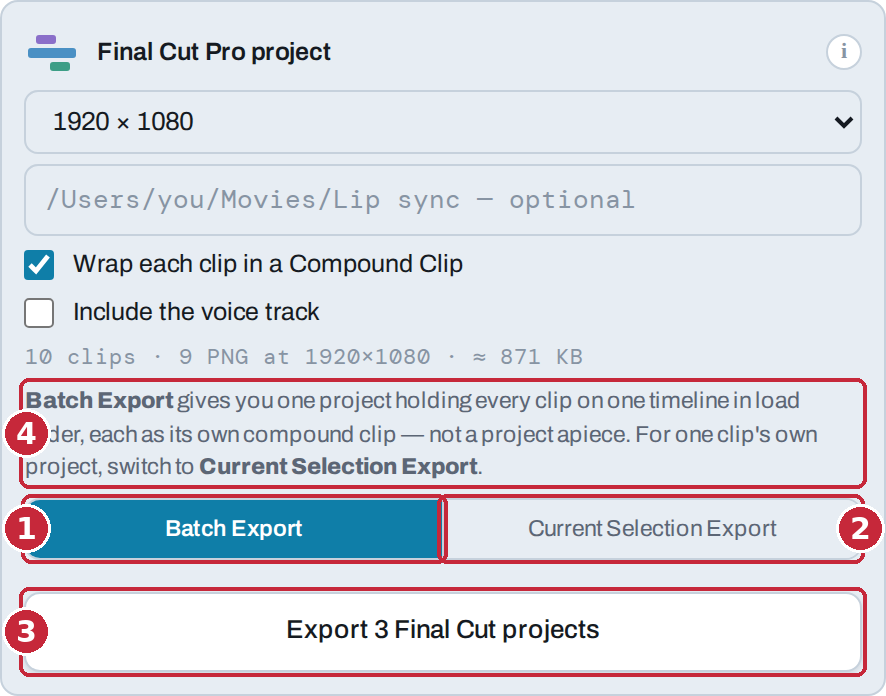

1. **Batch Export** — runs this format across every clip in the queue, analysing
   any that have not been yet, and using each clip's own edits, placement and
   mouth.
2. **Current Selection Export** — does the open clip only.
3. **The button** — says which it is about to do, and how many.
4. **Card note** — anything that differs between the two, spelled out.

Each card decides for itself, so you can batch the GIFs while pulling a single
Final Cut project for the clip in front of you.

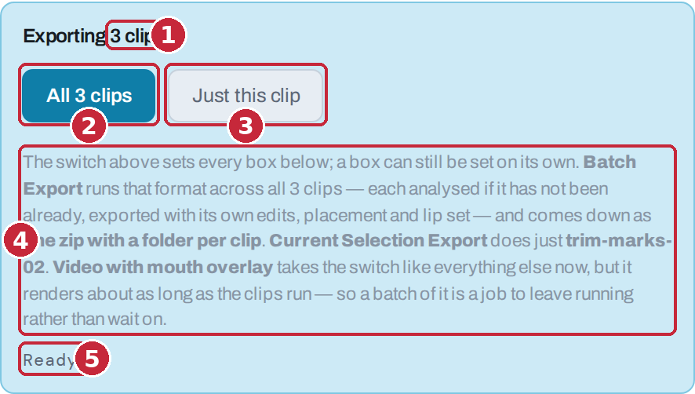

1. **Count** — how many clips a batch will cover.
2. **All *n* clips** — every card runs the whole queue.
3. **Just this clip** — every card runs the open clip only.
4. **What a batch does** — including which clip "current selection" means right
   now.
5. **Status** — progress during a run, and a **Stop** button beside it.

#### What a batch hands you

**One download**, a zip with everything in it side by side — no folder per
clip. Each file is named for the clip it came from, so a format that makes a
whole set apiece (a frame sequence is hundreds of PNGs) still sorts into runs
by name. Not one download per clip: a browser will only let a page start one
download from a click, and the rest get dropped or blocked, which looks exactly
like "only the first clip exported".

**Final Cut is the exception**, because its batch output is naturally a single
document: you get one project holding every clip on one timeline in load order,
each as its own compound clip — not a project apiece. For one clip's own
project, switch that card to **Current Selection Export**.

**Video with mouth overlay is the whole stage.** It burns in everything the
stage shows — the other layers, the balloons, the line boil, the drop shadows —
because it composes each frame through the same compositor the preview uses.
Its two boxes decide how much of that goes in:

- **Include the other layers** — ticked, the backgrounds, pictures, balloons
  and captions come too. Unticked, it is your footage or your puppet with the
  mouth on it and nothing else added.
- **Include the effects** — the line boil and the drop shadows, as above.

**And it takes the batch switch too.** It used to be the one card
that ignored it and quietly did the open clip — press Export with **All 4
clips** chosen and one file comes back, which reads as an export that only did
the last one. It batches like the rest now. It does render roughly as long as
the clips run, and the card says how long that will be, so a batch of it is a
job to leave running rather than one to wait on.

**Every clip in the queue goes in.** A clip is skipped only if it could not be
read at all. Length is not a reason — a clip over a minute is marked *long* in
the queue and named on the batch card before the run, so what you get is a
slower run rather than a shorter zip.

Stopping mid-run still gives you a zip of whatever finished.

---

## Putting the lips on a puppet

This app makes the mouth. Joining it to the puppet is the next program's job, and
every one of them does it differently.

Wherever you do it, two things have to be true: the mouth sits on its own layer
**above** the puppet, and something keeps the two together when the puppet moves.
Which export to take is mostly a question of which of those the tool can manage.

| Working in | Take | Because |
|---|---|---|
| ToonSquid | **Transparent GIF**, or **PNG frame sequence** | It animates a GIF, and imports a run of PNGs as consecutive drawings |
| Procreate Dreams | **Transparent GIF** | An animated GIF arrives as a Flipbook |
| iMovie, and most Windows editors | **Transparent GIF**, or **Chroma-key MP4** | Picture in Picture, or the green-screen mode |
| Anything that reads an **Animated PNG** | **Animated PNG** | One file, real alpha, no hard edge — try it before settling for the GIF |
| Final Cut Pro | **Final Cut Pro project**, or an **Animated PNG** | The project builds the timeline for you; the APNG is one file to drag in |
| After Effects, Blender, Spine, a game engine | **Chart + exposure sheet** or **PNG frame sequence** | Timing as data, or one PNG per frame |
| Nothing — you just want a finished clip | **Video with mouth overlay** | Done here, in one step |

Take the voice track with it unless the audio is already in your project — every
card has its own **Include the voice track**.

> **The Final Cut project takes the voice with it properly**
>
> On every other card, **Include the voice track** puts an audio file in the zip
> for you to drag in yourself. On the **Final Cut Pro project** it goes into the
> project as well: an asset in the document and a clip connected below the
> mouths at 00:00, so the timeline opens with picture and sound already
> together. Keep the audio file in the folder with the `.fcpxml` and the PNGs —
> the project points at it by name, the same way it points at the pictures.
>
> A batch run does the same for every clip, each one's voice under its own
> mouths at its own place on the timeline.

> **A trimmed clip's movie carries a trimmed voice**
>
> When the source is an MP4 or a MOV with an AAC track, the two movie exports
> copy that track out of the file rather than re-encoding it, which is exact
> and costs nothing. For a clip that has been trimmed or split, the copy is cut
> to the part of the file the clip uses — the card says *audio copied from the
> source, cut to this clip* when it is about to do that.
>
> This matters more than it sounds. A movie lasts as long as its longest track,
> so a four-second picture against a ninety-second sound track is a movie that
> plays its four seconds and then shows black for a minute and a half. The cut
> lands within about 23 milliseconds of the handle, which is inside one frame
> at 24fps; landing it to the sample would mean re-encoding, and a generation
> of quality for a twentieth of a frame is a bad trade.

> **Why there is no alpha movie**
>
> An HEVC `.mov` with an alpha channel is the file an iPad animation app would
> most like to be handed, and this page cannot make one. Chromium answers
> "Alpha encoding is not currently supported" to every codec it has, and Apple's
> HEVC-with-alpha is built by Apple's own tools. The **Animated PNG** is the
> nearest a browser can get on its own: one file, eight bits of alpha, no codec
> involved. For a real alpha movie, take the **PNG frame sequence** and convert it
> outside.

> **Final Cut Pro imports and plays animated PNGs**
>
> Worth knowing, because it is not documented anywhere obvious and most people
> assume a `.png` is a still. Drag one into an event and it arrives as a clip
> that animates, alpha and all — no conversion, no image sequence, one file.
> That makes it a real alternative to the **Final Cut Pro project** export when
> all you want is the mouths as a single item to drop over your own footage: the
> project is better when you want the run broken into clips you can re-time or
> correct, and the APNG is better when you do not.
>
> Other editors may well do the same. If yours opens a `.png` without complaint
> and it moves, you have found a shortcut.

### ToonSquid and Procreate Dreams (iPad)

Import the mouths and the voice track, drag them into the timeline above your
puppet, and resize and position them there.

Both can keep the mouth attached to the body so the two travel together, which is
worth setting up before you animate anything:

- **ToonSquid** calls it the **transform hierarchy** — the button in the
  timeline's bottom toolbar. Drag the mouth layer onto the body layer to make it
  a child, and scaling, rotating or moving the body does the same to the mouth.
  Layers inside a group are already in an implicit hierarchy with the group as
  their parent.
- **Procreate Dreams** groups instead: select the tracks in Timeline Edit, tap
  and hold, then **Group**. Movement, effects and filters applied to the group
  reach everything in it.

Either app will take the **Transparent GIF**, which is the quickest route: Dreams
reads an animated GIF as a Flipbook, and ToonSquid animates one too.

ToonSquid has a second route worth knowing about. Its **Image Sequence** import
takes a selected run of images, in filename order, and lays them out as
consecutive drawings on one animation layer — one mouth per drawing, the way you
would have drawn them yourself. Take the **PNG frame sequence** for that. It is more
files to shepherd, but the mouths arrive as real drawings you can paint on rather
than as a video clip, and the transparency is a full eight bits instead of the
GIF's on-or-off.

### iMovie, on Mac or iPad

Stack the audio first, then the puppet, then the mouths on top. Select the mouth
clip, open the **Video Overlay Settings** button — the overlapping squares — and
change the menu from **Cutaway** to **Picture in Picture**. That gives you the
resize and position handles.

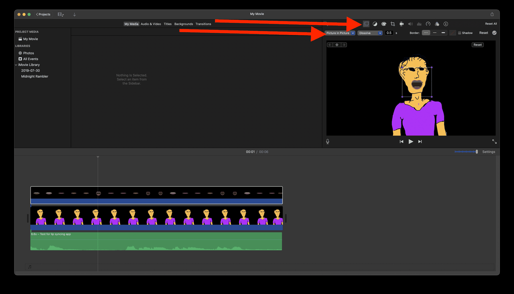

iMovie has no keyframing, so this suits a puppet that stays put. If the mouth
clip covers the face with a black rectangle, its transparency is not surviving
the import: switch the same menu to **Green/Blue Screen** and bring in the
**Chroma-key MP4** instead. Most Windows video editors have an equivalent pair of
features under different names.

### Final Cut Pro

Take the **Final Cut Pro project** export and **File > Import > XML** it. You get
a whole timeline built for you — one compound clip per clip — which you drag over
your puppet footage.

Then use Final Cut's own tracker: mask the face, track the movement, and attach
the mouths to it. That makes this the most flexible route by a good distance,
because the mouth can follow a puppet that moves. It is also the one that needs
software not everybody has.

Leave **Wrap … in a Compound Clip** ticked. Without it the mouths arrive as dozens
of loose one-frame pieces, and gathering them up is the first thing you would do
anyway.

### Straight from here, with nothing else

If you shot your puppet on video, you can finish in this page.

Load the video, pick a mouth style, then drag the mouth onto the face, size it
from the corner and tilt it with the knob. Turn on **Blur patch** to hide the
mouth printed on a doll or a minifigure, and export **Video with mouth overlay**.
The placement controls and that export only appear once a video is loaded, because
until then there is no picture to place anything on.

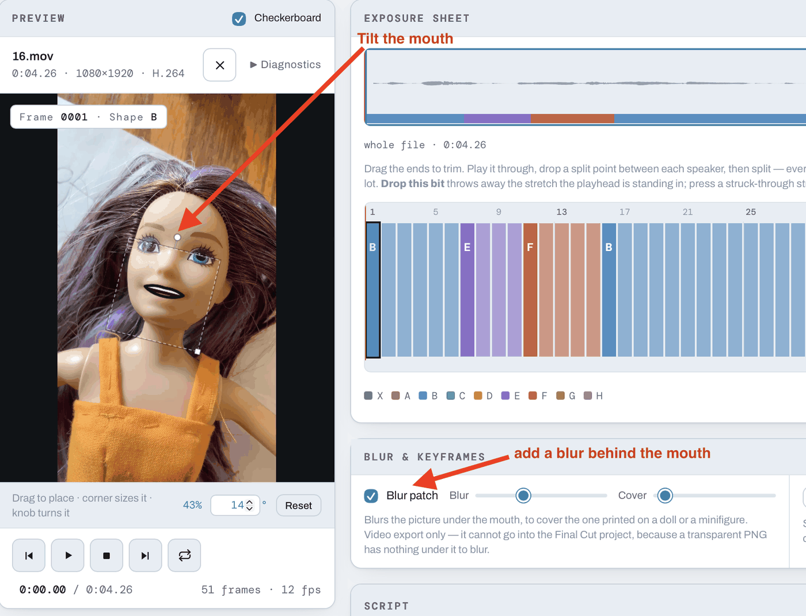

> ⚠️ **Lock the shot off**
>
> The mouth has one placement for the whole clip, so a puppet that wanders
> leaves it behind. Shoot on a tripod, hold the angle, and this export is
> solid. When the puppet really has to move, export the overlay video and track
> the mouth in an editor — that is a job Final Cut's tracker does properly.

### Puppets that are not facing you

The twenty-one styles each come in three head angles — **Front**, **Three-quarter**
and **Profile** — so a puppet can be turned away or side on and still get a mouth
that belongs to it. They are the sub-tabs under **Built-in lips**; see
[Head angles](#head-angles).

---

## Keyboard shortcuts

| Key | Does | Where |
|-----|------|-------|
| <kbd>Space</kbd> | Play / pause | anywhere\* |
| <kbd>Home</kbd> | Jump to the start | anywhere\* |
| <kbd>End</kbd> | Jump to the end | anywhere\* |
| <kbd>B</kbd> | Cut the clip in two at the playhead | anywhere\* except the sheet |
| <kbd>M</kbd> | Drop a marker at the playhead | anywhere\* |
| <kbd>X</kbd> <kbd>A</kbd>–<kbd>H</kbd> | Set the selected frames to that shape | exposure sheet |
| <kbd>←</kbd> <kbd>→</kbd> | Move the selection a frame | exposure sheet |
| <kbd>Shift</kbd> + <kbd>←</kbd> <kbd>→</kbd> | Extend the selection | exposure sheet |
| <kbd>Delete</kbd> | Clear the selection back to rest | exposure sheet |
| <kbd>Esc</kbd> | Collapse the selection to one frame | exposure sheet |
| <kbd>⌘A</kbd> / <kbd>Ctrl A</kbd> | Select every frame | exposure sheet |
| <kbd>⌘Z</kbd> / <kbd>Ctrl Z</kbd> | Undo | sheet, stage **or** timeline — whichever you touched last |
| <kbd>⇧⌘Z</kbd> / <kbd>Ctrl ⇧ Z</kbd> | Redo | the same |
| <kbd>←</kbd> <kbd>→</kbd> | Move between tabs | tab strip |
| <kbd>Shift</kbd> while turning | Snap the angle to 15° | stage |

\* Not while a field, menu or button has focus — there, the key belongs to that
control. Click an empty part of the page first and the transport keys come back.
<kbd>B</kbd> is the one key that means two things: inside the exposure sheet it
is the mouth shape B, because that is what a letter means in a sheet, and
everywhere else it is the blade.

---

## Limits

| | |
|---|---|
| Clips in the queue | 24 |
| Size of one batch download | 600 MB |

These are stated up front rather than discovered.

**The queue holds 24 clips**, and a split cannot push it past that. Ask for
more pieces than there is room for — "find the pauses" on a long conversation
can easily find thirty — and it cuts at as many points as will fit, says so,
and leaves the rest in the last piece for you to split again. Nothing is
thrown away; it is just not cut any finer in one go.

**Length is not a limit.** A clip over a minute is marked in the queue with an
amber dot reading *long — slower in a batch, but it does export*, and the batch
card names it before you start, because a long line makes a long run. It used
to be a red dot and a refusal: the clip was marked "too long", and a batch
skips anything marked — so choosing **All 4 clips** and pressing Export gave
back three, with the reason in a status line after the fact. The thing that
actually protects a run is the 600 MB below, measured as the zip is built.

A batch that would come to more than 600 MB stops and says so, rather than
handing the browser a file it cannot save. Frame sequences are the only export
that gets anywhere near this; everything else is orders of magnitude under.

---

## Troubleshooting

**The mouth chatters through silence.**
Raise the **silence gate**. A hissy or roomy recording sits further above the
noise floor than the analyser assumes.

**It flickers between shapes during speech.**
Raise the **minimum hold** to 3 frames. Anything shorter gets absorbed.

**The vowels are wrong.**
**Vocal tract size**. Lower it for a deep voice, raise it for a light one, until
"ee" and "oo" land on the shapes you expect.

**The batch only exported one clip.**
You are on an older build. A batch is one download now; if yours produces one
zip per clip, the browser is blocking the rest.

**In Final Cut, the GIF or the animated PNG is longer than the audio.**
Final Cut does not always hold the length of an animated GIF or PNG when it
imports one, and the further it drifts the longer the take. It is the import,
not the file: the same files line up exactly in ToonSquid and in a browser. Any
of these fixes it:

- Take the **Final Cut Pro project** instead. It is built for Final Cut, it is
  frame-accurate by construction, and it arrives as clips you can already edit.
- Split the take into shorter clips — see
  [Markers, splits and drops](#markers-splits-and-drops). A drift you cannot see over ten
  seconds is obvious over two minutes.
- Keep the clip and retime it: select it, **Modify > Retime > Custom**, and set
  the duration to the audio's. The mouths stay in step because the whole clip is
  stretched by one factor.

**Final Cut says the clips are missing.**
**File > Relink Files**, point it at the mouths folder, and they all reconnect at
once. Keeping the `.fcpxml` and its picture folders together avoids it entirely.

**The chroma-key edge is soft.**
Video chroma is half-resolution — that is the format, not the export. For a clean
matte use the **frame sequence** or the **Final Cut project**, both of which
carry real alpha.

**The GIF's edges are hard and the colours are flat.**
GIF transparency is one colour, not an alpha channel, and the palette is 255
colours. For a soft edge over video, use the frame sequence.

**My custom lips folder is not being found.**
The folder scan needs the page to be served over HTTP. Opened straight from disk,
browsers block it. Use **Use my own lips…** instead, which works everywhere.

**A video loads but shows no picture.**
The browser cannot decode that codec. The audio still analyses, and you can still
export everything except the overlay video. Re-wrapping the clip as H.264 fixes
it.

**The page went unresponsive.**
Decoding a long video blocks the browser for a few seconds. There is a spinner
that keeps turning through it — if you can see it turning, it has not crashed.

---

## Privacy

Nothing is uploaded. There is no server, no account, no analytics, and **no
network request of any kind** — not for your media, not for fonts, not for
anything. Everything the page needs travels inside it, typefaces included. The
audio is decoded in the page, analysed in the page, and written back out by the
page.

Custom lip sets you add with **Use my own lips…** live in memory for that visit
only: nothing is written to disk, nothing is stored in the browser, and reloading
clears them. Sets in a `lips/` folder beside the file are read from where they
already are.

You can put the whole thing on a USB stick and use it on a machine with no
network at all.

The line under the title bar says all of this in one sentence, where someone
being handed the tool for the first time will see it. The one thing that is not
quite "no request at all": served from a web server, the page asks that same
server for the `lips/` folder beside it, if you keep one. That is the only
fetch in the file, it goes nowhere but the host the page came from, and the
check that keeps this honest — `offlinetest.py` in the repository — runs the
page over HTTP and again from `file://` with the network refused, and fails if
anything else is requested.
